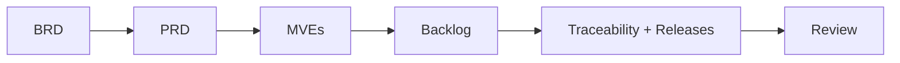

# Plan: Northwind product documents for BA-01 (Azure) and BA-02 (.NET)

| Field | Value |
|---|---|
| Task ID | `northwind-product-documents` |
| Date | 2026-10-30 |
| Plan artifact | `.copilot-tracking/plans/2026-10-30-northwind-product-documents-plan.md` |
| Research | `.copilot-tracking/research/2026-10-30/northwind-product-documents-research.md` (ready-with-gaps; 0 blocking) |
| Intake review | `.copilot-tracking/reviews/intake-validation-ba01-ba02.md` (Ready-With-Gaps; G-01..G-16) |
| Standards | `knowledge-docs/engineering-standards.md`: ES-01..ES-07, ES-30, ES-31, ES-39 (plus ES-27: nothing deployed) |
| Planning readiness | **Ready with gaps.** Gaps are carried as `ASSUMPTION:` or `OPEN:` items (section 7). |
| Critique | Skipped in the plan stage by the squad flow. The Review stage (tester) is the check (section 9). |
| Plan boundary | This plan describes documents to be written. It writes none of them, changes no code, deploys nothing, commits nothing and creates no Git tag. |

## 1. Executive summary

* Thirteen files are written under `docs/product/`: a business requirements document (BRD), a product requirements document (PRD), one experiments file with one Minimum Viable Experiment (MVE) per business area, a backlog, a traceability table, and one file per release.
* Scope is **BA-01 Platform and data-centre exit** (`track-azure`) and **BA-02 Ordering and customer self-service** (`track-dotnet`). **BA-03 Delivery claims and credit notes** is listed as out of scope in every document.
* **Release count (fixed): Azure 3 (`azure-r1`..`azure-r3`), .NET 4 (`dotnet-r1`..`dotnet-r4`).** Total 7 release files. The research slicing holds. Two small adjustments are made and justified in section 4.
* Every epic, feature and story carries exactly one track tag. Every planned item also carries exactly one release tag. Unplanned items carry only the track tag (ES-30, ES-31, ES-39).
* Cross-track dependencies are `OPEN:` items. No release waits for another track. Git tags `product/<track>-r<n>` are created only after the human approves the releases, and are not part of this plan.
* Document order: BRD, then PRD, then MVEs, then backlog, traceability and releases, then Review.

## 2. What you may not know

* **The roster root differs from the requested location.** `team.md` lists `.copilot-tracking/plans/` as the deliverable root for analyst, product-owner and experimenter. The caller and ES-07 require `docs/product/`. This plan follows ES-07 for the product documents. Only this plan file is in `.copilot-tracking/plans/`.
* **Order Desk code is not safe for customers as it stands** (research C5: no customer scoping). The tenant-isolation enabler `EN-DN-10` must come before every portal story that reads data.
* **BR-04 "always up to date" conflicts with the nightly 02:00 exchange** (CS-10, C-03). Stories state "as of the 02:00 batch" as an `ASSUMPTION:` (A-04) with `OPEN-01`.
* **The StockPilot exchange cannot move as written** (uses `xp_cmdshell` and a local `D:\` bulk load; research C3, W1). It is `MVE-BA01`.
* U1 (Entra External ID pricing, .NET 10 on App Service) was never verified. It is `A-21` and `OPEN-25`.

## 3. Phase checklist

| Phase | Outcome | Owner role (agent) | Depends on |
|---|---|---|---|
| P01 | `business-requirements.md` written | analyst (BRD Builder; PRD Builder is the roster primary) | this plan |
| P02 | `product-requirements.md` written | analyst (PRD Builder) | P01 |
| P03 | `experiments.md` written (`MVE-BA01`, `MVE-BA02`) | experimenter (Experiment Designer) | P01, P02 |
| P04 | `backlog.md` written | product-owner (Functional Planner) | P01..P03 |
| P05 | `traceability.md` and the 7 release files written; optional `README.md` index | product-owner (Functional Planner) | P04 (same pass) |
| P06 | Review report and fixes list | tester (Squad Reviewer); optional intake-validator (PRD/BRD Quality Reviewer) | P01..P05 |

Parallelism: none between P01..P05 because each document reuses IDs, tags and numbering from the previous one. P04 and P05 are one product-owner pass. The seven release files in P05 can be written as one parallel batch once `backlog.md` is final.

## 4. Release plan (fixed)

Release counts come from backlog priority: Must before Should before Could, with enablers before the features that need them (ES-31). Dates are `ASSUMPTION:` A-07 (owner: Marc Dubois, Lena Varga) and may only be stated as targets.

### 4.1 Azure: 3 releases (`track-azure`)

| Release | File | Git tag (after approval only) | Theme | Contents (enabler and feature IDs) | Covers |
|---|---|---|---|---|---|
| `azure-r1` | `docs/product/releases/azure-r1.md` | `product/azure-r1` | Foundation and proof | `EN-AZ-01` foundation (France Central, naming, tags, Bicep + AVM, `tst` and `prd` skeleton); `EN-AZ-02` network foundation and private endpoints; `EN-AZ-03` hosting and data ADR; `EN-AZ-04` secrets and managed identity (tst); `EN-AZ-05` observability baseline (tst); `EN-AZ-07` infrastructure pipeline; `EN-AZ-12` cost model; feature stories that record the `MVE-BA01` outcome | NFR-05 (platform), NFR-03 (platform), NFR-01 (design and measure), NFR-06 (design), C-04 (estimate) |
| `azure-r2` | `docs/product/releases/azure-r2.md` | `product/azure-r2` | Production cutover | `EN-AZ-14` hybrid connectivity to Antwerp; `EN-AZ-06` backup, DR and tested restore; `EN-AZ-08` database migration rehearsal; `EN-AZ-09` StockPilot exchange redesign; `EN-AZ-10` invoice store migration; `EN-AZ-11` SMTP relay replacement; `EN-AZ-13` cutover runbook and rollback; `prd` secrets and observability; feature stories for the Sunday-window cutover | BR-13, NFR-01, NFR-03, NFR-05, NFR-06, C-01, C-03 |
| `azure-r3` | `docs/product/releases/azure-r3.md` | `product/azure-r3` | Stabilise and decommission | Decommission NWWEB01 and NWSQL01 (NWFS01 only if `OPEN-12` says it counts); cost check against C-04; DR test report; runbooks | SM-07, C-04, NFR-06 (tested) |

Reason to keep three: the exchange and database unknowns need an early proof (r1). Cutover is the only Must outcome (r2). SM-07 (zero servers past end of support) has no value until cutover, so decommissioning is its own approvable release (r3). Merging r3 into r2 would hide the closing measure.

### 4.2 .NET: 4 releases (`track-dotnet`)

| Release | File | Git tag (after approval only) | Theme | Contents | Covers |
|---|---|---|---|---|---|
| `dotnet-r1` | `docs/product/releases/dotnet-r1.md` | `product/dotnet-r1` | Modernised Order Desk (enabler release) | `EN-DN-01` SDK-style on `net10.0`; `EN-DN-02` tests pass on Windows, macOS, Linux; `EN-DN-03` configuration; `EN-DN-04` logging; `EN-DN-05` no secrets or Integrated Security (application side); `EN-DN-06` draft order session; `EN-DN-07` invoice storage abstraction; `EN-DN-09` build and test pipeline; staff-visible BR-10 feature stories | NFR-05 (application), BR-10 (staff view), ES-14..ES-19 |
| `dotnet-r2` | `docs/product/releases/dotnet-r2.md` | `product/dotnet-r2` | Portal pilot: Must items | `EN-DN-11` portal ADR; `EN-DN-10` tenant isolation; `EN-DN-08` staff Entra sign-in; `EN-DN-12` localisation scaffold; `EN-DN-13` audit completeness; `EN-DN-14` accessibility baseline; features for BR-01..BR-06, BR-10 (portal stamp), BR-12 | BR-01..BR-06, BR-10, BR-12, NFR-02, NFR-03 (application), NFR-04, NFR-07, NFR-08 |
| `dotnet-r3` | `docs/product/releases/dotnet-r3.md` | `product/dotnet-r3` | Should items | BR-07 invoices, BR-08 customer administrator, BR-11 French and English | BR-07, BR-08, BR-11 |
| `dotnet-r4` | `docs/product/releases/dotnet-r4.md` | `product/dotnet-r4` | Could items and measures | `EN-DN-15` store shipment date and carrier (new, see below); BR-09 shipped e-mail; stories that measure SM-01..SM-04 | BR-09, SM-01..SM-04 |

Reason to keep four: `dotnet-r1` is the largest technical enabler and has an early, small, approvable outcome with a test baseline (research C13, ES-18). `dotnet-r2` is the Must pilot. `dotnet-r3` and `dotnet-r4` follow MoSCoW. If the product owner wants value earlier, `dotnet-r2` may later be split into a read-only slice and a reorder slice. That is a decision for the product owner, not a change made here (`OPEN-26`).

### 4.3 Adjustments to the research slicing (justified)

| # | Change | Why |
|---|---|---|
| J-1 | Research `AZ-EN-02` is split into `EN-AZ-02` (network foundation and private endpoints, `azure-r1`) and `EN-AZ-14` (hybrid connectivity to Antwerp, `azure-r2`) | `EN-AZ-04` and `EN-AZ-05` in r1 need private endpoints (ES-25). The Antwerp path depends on `OPEN-07` (answer pending) and the cutover, so it stays in r2. |
| J-2 | New `EN-DN-15` in `dotnet-r4`: store `ShippedAt` and `Carrier` | BR-09 needs data the import reads but never keeps (research C3). Any exchange or schema effect is `OPEN-20`, not a dependency. |

Research candidate IDs `AZ-EN-nn` and `DN-EN-nn` become `EN-AZ-nn` and `EN-DN-nn` with the same number (except J-1 and J-2). The BRD, PRD and backlog use only the new form.

## 5. Common conventions (all documents must follow)

### 5.1 Item ID scheme

| Item | Pattern | Example |
|---|---|---|
| Epic | `EP-<AZ|DN>-nn` | `EP-AZ-01` |
| Feature | `FT-<AZ|DN>-nn` (number runs per track, not per epic) | `FT-DN-07` |
| User story | `US-<AZ|DN>-nnn` | `US-DN-014` |
| Enabler story | `EN-<AZ|DN>-nn` (a story with `Type: Enabler`, written as As a / I want / so that, with Given/When/Then) | `EN-AZ-04` |
| Experiment | `MVE-BA01`, `MVE-BA02` | |
| Assumption | `A-nn` | `A-04` |
| Open item | `OPEN-nn` | `OPEN-01` |
| Release | `azure-r<n>`, `dotnet-r<n>` | |

`AZ` is the Azure track code and `DN` the .NET track code. Numbers are never reused or renumbered after the backlog is written. An item that is dropped is marked `Dropped` with the reason.

### 5.2 Tagging convention

* Every item line starts with a **Tags** field: `Tags: track-azure, azure-r2` (planned) or `Tags: track-dotnet` (not planned).
* Exactly **one** track tag per epic, feature and story (ES-30): `track-azure` or `track-dotnet`. `track-power-platform` is never used.
* **At most one** release tag, and only the tag of the same track. A `track-azure` item may carry only `azure-r1`..`azure-r3`. A `track-dotnet` item may carry only `dotnet-r1`..`dotnet-r4` (ES-31).
* A planned item has both tags. An unplanned item has the track tag only.
* **Parent and child share track and release.** Epics are release-scoped (one epic per release theme), so a parent never spans releases. Unplanned parents have only unplanned children.
* A story that needs both tracks is split into one story per track (ES-30). The two stories cite the same `BR-`/`NFR-` and the same `OPEN-` item.
* The tag wording matches the publishing tools (ES-39): Azure DevOps tags, GitHub labels with one milestone per release, Jira labels with one fix version per release. The publishing tool is `OPEN-11`.
* Required fields per item: ID, title, Tags, Type (Epic, Feature, Story, Enabler), Priority (Must, Should, Could), source identifiers `(source: ...)` (ES-02), status (`Draft`). Stories add *As a ... I want ... so that ...* and Given / When / Then criteria (ES-05). Enablers name the story or feature they unblock.
* Backlog order: by release, then Must, Should, Could, with enablers before the features they unblock. Within one track the order never depends on the other track.

### 5.3 Shared numbering of assumptions and open items

The seed registers below are fixed by this plan so that all documents use the same IDs. `docs/product/README.md` (mandatory in this plan) holds the master registers. Every document shows the entries it uses with identical wording and IDs. A new entry takes the next free number, is added to the master register in the same pass, and is never renumbered. `A-` and `OPEN-` replace research labels `AS-`, `G-`, `X-`, `OQ-` in the product documents. The "Research ref" column is for authors and may be removed from the final files.

**Assumptions (ES-03)**

| ID | ASSUMPTION | Owner who can confirm | Research ref |
|---|---|---|---|
| A-01 | File names under `docs/product/` as pinned in section 6 | Lena Varga | AS-01 |
| A-02 | NFR-03, NFR-04 and NFR-05 are cross-cutting: one story per track, both shown in the traceability table. Exception: NFR-04 gets an Azure story only if `OPEN-03` or `OPEN-13` assigns platform sign-in plumbing to Azure; until then the traceability table shows the Azure side as "OPEN-13, no Azure story" | Lena Varga | AS-02, G-03 |
| A-03 | The .NET track owns Order Desk code modernisation; the Azure track owns hosting, data and the exchange | Ahmed Benali | AS-03, X-01 |
| A-04 | BR-04 stories state "as of the 02:00 batch" freshness | Lena Varga | AS-04 |
| A-05 | Confirmed, Delivered and Cancelled are manual staff actions today | Order Desk team via Lena Varga | AS-05 |
| A-06 | Experiment success thresholds and pivots in `experiments.md` | Lena Varga, Ahmed Benali | AS-06 |
| A-07 | Release target dates (azure-r1 end Jan 2027; azure-r2 rehearsal by end Apr, cutover May 2027; azure-r3 by 30 Jun 2027; dotnet-r1 end Feb 2027; dotnet-r2 pilot start Apr 2027; dotnet-r3, dotnet-r4 not dated) | Marc Dubois, Lena Varga | AS-07 |
| A-08 | Release names `azure-r<n>`, `dotnet-r<n>` and Git tags `product/azure-r<n>`, `product/dotnet-r<n>` | Lena Varga | AS-08, G-14 |
| A-09 | The cost model assumes SQL and private endpoints are the main spend | Ahmed Benali | AS-09 |
| A-10 | Time zone behaviour on Azure may differ from the Lyon servers (UTC vs CET) | Ahmed Benali | AS-10, C10 |
| A-11 | NFR-01 covers the Order Desk and the portal; availability is measured by a probe | Lena Varga | NFR-01 row, G-11 |
| A-12 | NFR-01..NFR-08 have no priority in the business case. The backlog orders them by the release they gate and shows the release | Lena Varga | G-11 |
| A-13 | The portal is a responsive web site for current browsers (mobile via browser) | Sofie Peeters, Ahmed Benali | G-13 |
| A-14 | The EUR 1,500 per month ceiling (C-04) is shared by both tracks | Marc Dubois | G-06 |
| A-15 | The BRD keeps the business-case identifiers `C-01`..`C-08` for constraints | Lena Varga | G-15 |
| A-16 | These drafts are discovery outputs, not approved for build | Lena Varga | G-16 |
| A-17 | Move items without a BR or NFR (SMTP relay CS-12, invoice share CS-08/CS-11, monitoring CS-22, DR CS-23, pipeline CS-19) are enabler stories tagged by track | Lena Varga | G-09 |
| A-18 | BR-10 stories are small: show the channel, filter by it, and set the Portal channel on the server | Lena Varga | C1 |
| A-19 | The import's repeated "Shipped" audit rows (research C4) are unintended; the exchange redesign decides to keep or fix them, with a decision record (ES-19) | Ahmed Benali | C4 |
| A-20 | `ShippedAt` and `Carrier` must be stored for BR-09 | Ahmed Benali | C3 |
| A-21 | Entra External ID pricing and limits, and .NET 10 on Azure App Service, are not verified | Ahmed Benali | U1 |

**Open items (ES-04, ES-31)**. "Cross-track" items appear in the release files of both tracks under the same ID.

| ID | OPEN question or dependency | Person who can answer | Cross-track? | Research ref |
|---|---|---|---|---|
| OPEN-01 | Acceptable freshness for BR-04 (nightly?) | Lena Varga | dotnet, azure (exchange) | G-01 |
| OPEN-02 | Source of Confirmed, Delivered, Cancelled status | Lena Varga with the Order Desk team | dotnet | G-02 |
| OPEN-03 | Who modernises Order Desk code (CS-13..CS-17, .NET 10, staff Entra sign-in) | Ahmed Benali with Lena Varga | **yes** | G-04, X-01 |
| OPEN-04 | Accountable owner and split of the EUR 1,500 ceiling | Marc Dubois | **yes** | G-06, X-06 |
| OPEN-05 | Meaning of "portal launch"; does the pilot run on Azure before 30 June 2027 | Marc Dubois, Lena Varga | **yes** | G-07, G-08, X-08 |
| OPEN-06 | How finance invoice output reaches Azure; where Order Desk reads it | Julien Moreau | **yes** | G-09, X-05 |
| OPEN-07 | Network path from Azure to Antwerp and the SFTP host location | Ahmed Benali with Pieter Janssens | azure | G-10 |
| OPEN-08 | NFR measurement bases (NFR-01, NFR-02, NFR-08) | Lena Varga | both | G-11 |
| OPEN-09 | 24 months of orders exist; where `Orders.InvoiceNumber` is filled; invoice year rule | Julien Moreau, Ahmed Benali | dotnet | G-12, C7 |
| OPEN-10 | Data-protection requirement for customer users (Ahmed Benali); mobile expectations (Sofie Peeters) | Ahmed Benali, Sofie Peeters | dotnet | G-13 |
| OPEN-11 | Backlog publishing tool (ES-39) | Lena Varga | both | G-14 |
| OPEN-12 | NWFS01 operating system and whether it counts in SM-07 | Ahmed Benali | azure | G-16 |
| OPEN-13 | Customer identity provider vs the Entra tenant and platform sign-in plumbing | Ahmed Benali | **yes** | OQ-01, X-03 |
| OPEN-14 | Dutch in the first release | Sofie Peeters with Lena Varga | dotnet | OQ-02 |
| OPEN-15 | Customer administrators for all customers or only large ones | Lena Varga | dotnet | OQ-03 |
| OPEN-16 | Show volume and Gold discounts to customers, or only the net price | Lena Varga | dotnet | C6 |
| OPEN-17 | Is the free-text audit action enough for NFR-08 or are field-level changes needed | Lena Varga | dotnet | C9 |
| OPEN-18 | SMTP relay replacement (azure) vs BR-09 and confirmation e-mail; who sends today (no mail code in `src/`) | Ahmed Benali | **yes** | C14, X-09 |
| OPEN-19 | Hosting and database target the portal and modernised app run on (instance count, session state) | Ahmed Benali | **yes** | X-02 |
| OPEN-20 | StockPilot exchange redesign vs BR-04 freshness and any .NET schema change (migration-impact check) | Lena Varga (freshness), Ahmed Benali (schema) | **yes** | X-04 |
| OPEN-21 | CI/CD ownership: build and test pipeline vs deployment pipeline | Ahmed Benali | **yes** | X-07 |
| OPEN-22 | 7-year audit retention: sizing, backup and retrieval vs RPO/RTO | Lena Varga, Ahmed Benali | **yes** | X-10 |
| OPEN-23 | Time zone and clock for batch times, order dates, audit | Ahmed Benali | **yes** | X-11 |
| OPEN-24 | Informational: BA-03 will need an Order Desk API (CS-27, ES-36). BA-03 is out of scope; no release depends on it | Ahmed Benali | informational | X-12 |
| OPEN-25 | Verify Entra External ID pricing and .NET 10 on App Service | Ahmed Benali | dotnet | U1 |
| OPEN-26 | Split `dotnet-r2` into a read-only slice and a reorder slice? | Lena Varga | dotnet | section 7 |

Which cross-track items each release must list (as `OPEN:`, never as a prerequisite):

| Release | Cross-track OPEN IDs to state |
|---|---|
| `azure-r1` | OPEN-03, 04, 05, 13, 19, 21 |
| `azure-r2` | OPEN-01, 03, 04, 05, 06, 18, 19, 20, 22, 23 |
| `azure-r3` | OPEN-04, 12 |
| `dotnet-r1` | OPEN-03, 04, 19, 21, 23 |
| `dotnet-r2` | OPEN-01, 03, 04, 05, 13, 19, 20, 22 |
| `dotnet-r3` | OPEN-06, 19 |
| `dotnet-r4` | OPEN-18, 20 |

## 6. Files and deliverables (execution order)

All paths are under `docs/product/` (ES-07). Every file starts with a header (title, status `Draft - for review`, date, scope line, source list) and ends with the Assumptions and OPEN tables for the IDs it uses (section 5.3). Plain language (ES-01). Every requirement and story cites its source (ES-02).

| # | Deliverable | Path | Owning role (agent) | Depends on | Must contain |
|---|---|---|---|---|---|
| D1 | Business requirements document | `docs/product/business-requirements.md` | analyst (BRD Builder) | this plan | Purpose; scope (BA-01, BA-02 in; BA-03 and business-case section 6 exclusions out); stakeholders; business context and current-state facts (CS-); all in-scope BR-, NFR-, C-, SM-, OQ- with source and priority; cross-cutting split table (NFR-03/04/05, ES-30); risks; A- and OPEN- tables |
| D2 | Product requirements document | `docs/product/product-requirements.md` | analyst (PRD Builder) | D1 | Product vision per track; the planned releases (3 Azure, 4 .NET) with themes and the requirements each covers; functional and non-functional requirements citing BR-/NFR-; enablers and why they come first; constraints (ES-20..ES-27, ES-13..ES-19); cross-track OPEN items; out of scope |
| D3 | Experiments | `docs/product/experiments.md` | experimenter (Experiment Designer) | D1, D2 | Exactly two MVEs (section 7, P03); a short "assumptions considered, not chosen" list (A2, A3, A4, B2, B3, B4 with why) that is not a third MVE |
| D4 | Backlog | `docs/product/backlog.md` | product-owner (Functional Planner) | D1..D3 | Epics, features, stories and enablers per section 5; Given / When / Then; tags; priority; sources; unplanned items; assumption and OPEN tables |
| D5 | Traceability | `docs/product/traceability.md` | product-owner (Functional Planner) | D4 | Table of every in-scope BR- and NFR- mapped to stories (by track, with release); "Not covered" list (or `none`); out-of-scope BA-03 list; constraints and success measures mapped to where they are carried |
| D6 | Azure releases (3) | `docs/product/releases/azure-r1.md`, `azure-r2.md`, `azure-r3.md` | product-owner (Functional Planner) | D4 | Per ES-31: stories, BR-/NFR- covered, what the release leaves out, dependencies on other tracks as `OPEN:`, status line "Draft - not approved - not tagged" and the future Git tag name |
| D7 | .NET releases (4) | `docs/product/releases/dotnet-r1.md`, `dotnet-r2.md`, `dotnet-r3.md`, `dotnet-r4.md` | product-owner (Functional Planner) | D4 | Same as D6 |
| D8 | Index and master registers | `docs/product/README.md` | product-owner (Functional Planner) | D1..D7 | Reading order, file list, ID and tag conventions, master A- and OPEN- registers, release table, status |
| D9 | Review report | `.copilot-tracking/reviews/product-documents-review.md` | tester (Squad Reviewer) | D1..D8 | Verdict and findings against section 9 |

Total product files under `docs/product/`: 5 core (D1..D5) + 7 releases + 1 README = 13. Output of D1..D8 is nowhere else. The README is mandatory in this plan because it holds the master registers.

Dependency order: D1 -> D2 -> D3 -> D4 -> {D5, D6, D7} -> D8 -> D9. D5, D6 and D7 may be written in one parallel batch after D4 is final. No deliverable depends on a different track's release.

## 7. Planned content per phase (what each author must do)

### P01 / D1 Business requirements document
* Cover BR-13, NFR-01, NFR-03, NFR-05, NFR-06, C-01..C-04, C-06, SM-07 (BA-01) and BR-01..BR-12, NFR-02, NFR-04, NFR-05, NFR-07, NFR-08, C-05, SM-01..SM-04, OQ-01..OQ-03 (BA-02) with cited sources (business-case section 4, current-state CS- facts).
* Mark conflicts as findings: BR-04 vs CS-10 and C-03 (`OPEN-01`, A-04); BA-01 vs BA-02 wording on the Order Desk upgrade (`OPEN-03`, A-03); CS-12 vs `src/` (`OPEN-18`).
* Code and database findings from research (C1..C17) are used only to explain risk, each marked `ASSUMPTION:` where not in knowledge-docs (ES-03).
* List out of scope: BA-03 and BR-14..BR-19, NFR-09, C-07, C-08, SM-05, SM-06, OQ-04, OQ-05, CS-24..CS-28, ES-32..ES-37, plus the section 6 exclusions (online payment, native mobile app, StockPilot changes, replacing the finance system, customer-recorded claims).

### P02 / D2 Product requirements document
* One section per planned release (3 + 4), with theme, target (A-07), requirements covered, left out, and the cross-track `OPEN:` items from the table in section 5.3.
* State the ordering rule and the rule that no release waits for another track. Where a release needs something from the other track (for example `azure-r2` needs the application to run on the target, `dotnet-r2` needs a pilot environment), write it as an `OPEN:` item and state what the release does without the answer. Do not write "requires" or "blocked by" for another track.
* Include the NFR measurability notes (A-11, A-12, `OPEN-08`).

### P03 / D3 Experiments
Two MVEs only. Design and review only: nothing is deployed, no change to `src/`, `database/`, `infra/`, no production data moved (ES-27).

| MVE | Business area | Riskiest assumption | Cheap test | Success and pivot (all `ASSUMPTION:` A-06) |
|---|---|---|---|---|
| `MVE-BA01` | BA-01 Azure (`track-azure`) | The nightly StockPilot exchange can be reproduced in an Azure-compatible way with identical files, 02:00 cadence and paths, and no StockPilot change (research A1; C3, C4, W1, CS-10, C-03) | One-page design plus a throwaway local proof on a developer SQL Server that writes `orders_YYYYMMDD.csv` and ingests a sample `shipments.csv` without `xp_cmdshell` or a local `D:\` bulk load; compare bytes with the legacy output on 3 sample runs; a 30-minute call with Antwerp IT for the SFTP host, account type and pick-up window | Identical bytes on 3 runs, a named network path and Antwerp confirmation. Pivot: if identical files need SQL on a VM, redo the cost option check with that cost (`EN-AZ-12`) |
| `MVE-BA02` | BA-02 .NET (`track-dotnet`) | A status view only as fresh as the 02:00 update is enough that customers stop calling "where is my order?" (research B1; P-03, BR-04, CS-10, SM-02) | Concierge test: about 10 of the 20 pilot customers get a daily 08:00 status e-mail labelled "as of 02:00" for 2 weeks, built from existing status data; compare their weekly status calls to their own earlier 2 weeks; 2-question survey | At least 30 % fewer such calls and at least 70 % say it was enough. Pivot: re-open BR-04 freshness (`OPEN-01`) with Lena Varga and raise the StockPilot constraint |

Each MVE section has: hypothesis, why it is the riskiest, test, who runs it, duration, success and pivot thresholds, effect on the backlog (which stories are confirmed, resized or dropped), and sources. The experiment owner for `MVE-BA01` is Ahmed Benali (ASSUMPTION), and for `MVE-BA02` Lena Varga (ASSUMPTION); both go into the assumptions table.

### P04 / D4 Backlog (epics and enabler content)
Authors start from this skeleton. The count of features and stories is the author's call; the rule is that every in-scope BR and NFR (BR-01..BR-13, NFR-01..NFR-08) gets at least one story.

| Epic | Track | Release | Contains |
|---|---|---|---|
| `EP-AZ-01` Foundation and proof | `track-azure` | `azure-r1` | `EN-AZ-01`, `02`, `03`, `04`, `05`, `07`, `12`; NFR-03, NFR-05, NFR-01 stories |
| `EP-AZ-02` Production cutover | `track-azure` | `azure-r2` | `EN-AZ-14`, `06`, `08`, `09`, `10`, `11`, `13`; BR-13 cutover features; NFR-01, 03, 05, 06 on `prd` |
| `EP-AZ-03` Stabilise and decommission | `track-azure` | `azure-r3` | decommission, DR test report, cost check, runbooks; SM-07, C-04, NFR-06 |
| `EP-DN-01` Modernised Order Desk | `track-dotnet` | `dotnet-r1` | `EN-DN-01`..`07`, `09`; BR-10 staff view; NFR-05 application story |
| `EP-DN-02` Secure access and tenant isolation | `track-dotnet` | `dotnet-r2` | `EN-DN-11`, `10`, `08`; BR-01; NFR-04, NFR-03 application story |
| `EP-DN-03` See my orders | `track-dotnet` | `dotnet-r2` | BR-02, BR-03, BR-04, BR-12; NFR-02 |
| `EP-DN-04` Reorder and hand-off | `track-dotnet` | `dotnet-r2` | BR-05, BR-06, BR-10 portal stamp; `EN-DN-13` |
| `EP-DN-05` Portal quality | `track-dotnet` | `dotnet-r2` | `EN-DN-12`, `14`; NFR-07, NFR-08 |
| `EP-DN-06` Self-service extras | `track-dotnet` | `dotnet-r3` | BR-07, BR-08, BR-11 |
| `EP-DN-07` Notifications and measures | `track-dotnet` | `dotnet-r4` | `EN-DN-15`; BR-09; SM-01..SM-04 measurement |

Unplanned items (track tag only) are allowed for: Dutch language (`OPEN-14`), field-level audit (`OPEN-17`), and an Order Desk API for reuse (`OPEN-24`; no BA-03 story is written). Any other unplanned item needs a reason and an `OPEN:` or `ASSUMPTION:`.

Story rules (each must be buildable by a developer who has not read the business case, ES-05):
* Form *As a ... I want ... so that ...* with at least one Given / When / Then block per story. Enablers use the same form and name what they unblock.
* Acceptance criteria are checkable. Where the business case gives no number, the number is marked `ASSUMPTION:` with an A- ID (for example NFR-02 load basis, `OPEN-08`).
* Azure stories that mention infrastructure state "validated with `az bicep build`; nothing deployed" (ES-27), name resources by ES-23 and the four tags by ES-24 where relevant, and use France Central (ES-20).
* No secret, key, connection string, tenant ID, subscription ID or password appears in any document (ES-17, NFR-05). Use placeholders.
* BR-04 stories state "as of the 02:00 batch" as A-04. BR-10 stories follow A-18. BR-12 stories include `OPEN-16`.
* `EN-DN-10` (tenant isolation) precedes every portal data story and is cited by it. Cite C5 only as an `ASSUMPTION:`-labelled finding.

### P05 / D5, D6, D7, D8
* **Traceability (ES-06):** one row per in-scope ID: BR-01..BR-13 and NFR-01..NFR-08 (NFR-09 is BA-03 and out of scope). Columns: ID, area, track, covering story IDs (with release tag), status (`Covered`, `Partly covered`, `Not covered`). A "Not covered" section lists every in-scope ID with no story, or says `none`. NFR-03, NFR-04 and NFR-05 show one story per track. A second table maps C-, SM- and OQ- to where they are carried. A third table lists BA-03 as out of scope with its IDs.
* **Releases:** each file follows ES-31 and has: header (track, release tag, planned Git tag `product/<track>-r<n>`, status "Draft - awaiting approval - not tagged", target A-07); theme; stories table (ID, title, priority, tags, sources); BR-/NFR- covered; left out (with the release where each lands, or `unplanned`); cross-track dependencies as `OPEN:` per the table in section 5.3, each with "what this release does without the answer"; assumptions used. A release lists no other release's tag on its items.
* **README:** states that nothing is deployed, committed or tagged and that Git tags are created only after the human approves each release.

## 8. Scope notes the authors must carry
* Cross-cutting split (A-02): NFR-05 (`EN-AZ-04` platform; `EN-DN-05` application); NFR-03 (`EN-AZ-01` regions and EU-resident backups and logs; a .NET portal data-residency story); NFR-04 (a .NET story for customer sign-in and staff Entra; an Azure story only if `OPEN-03` or `OPEN-13` assigns platform plumbing to Azure); NFR-06 (Azure) and NFR-08 (.NET) linked by `OPEN-22`.
* **One primary story per track per cross-cutting NFR** is the minimum. Follow-on stories are allowed when each is in one release (for example NFR-05 on `prd` in `azure-r2`).
* Constraints C-01..C-06 and success measures SM-01..SM-04, SM-07 are carried as constraints and measures. SM-01 and "portal launch" stay `OPEN-05`.

## 9. Acceptance and quality criteria for the Review stage (tester)

The review passes only if all are true. The reviewer records a verdict per criterion with the file and line or heading.

| # | Criterion | Check |
|---|---|---|
| Q-01 | All 13 files exist at the pinned paths, and nothing was written elsewhere except the review file | list files |
| Q-02 | **Scope:** only BA-01 and BA-02 content. BA-03 appears only in out-of-scope lists (and `OPEN-24` as informational) | search for BR-14..BR-19, NFR-09 |
| Q-03 | **Traceability:** every BR-01..BR-13 and NFR-01..NFR-08 maps to at least one story; any uncovered ID is listed under "Not covered"; story IDs in `traceability.md` exist in `backlog.md` and agree on track and release | cross-check |
| Q-04 | **Cross-cutting NFRs:** NFR-03, NFR-04 (when in scope for both) and NFR-05 each have at least one story per track; no story is tagged with two tracks | tag check |
| Q-05 | **Tags (ES-30, ES-31):** every epic, feature, story and enabler has exactly one track tag; planned items have exactly one release tag of the same track; unplanned items have none; no item lists two releases; parent and child share track and release | tag scan |
| Q-06 | **Release membership matches** across `backlog.md`, `traceability.md`, the release file and the PRD (same story set, same release) | cross-check |
| Q-07 | **Release counts** are 3 Azure and 4 .NET, with the file names and Git tag names in section 4. Git tag names appear only as planned text. No tag, commit or deployment was created | file and repo check |
| Q-08 | **No release waits on another track:** each cross-track dependency is an `OPEN-` item with a stated "does without" outcome; no release says "requires", "blocked by" or "after" another track's release | search wording |
| Q-09 | **Stories (ES-05):** every story and enabler has As a / I want / so that and at least one Given / When / Then block that is testable | story scan |
| Q-10 | **Sources (ES-02):** every requirement and story cites source IDs that exist in knowledge-docs (or a labelled research finding marked `ASSUMPTION:`) | spot-check all |
| Q-11 | **ASSUMPTION and OPEN (ES-03, ES-04):** every one is in a table with an owner or a named person; IDs `A-nn` and `OPEN-nn` are identical in meaning and wording in every file and in the README master register; none is presented as a requirement | cross-check |
| Q-12 | **Enablers before features:** each track's enablers appear before the features that need them, in release order and in backlog order; every enabler names what it unblocks | order check |
| Q-13 | **MVEs:** exactly two (`MVE-BA01`, `MVE-BA02`), each with the riskiest assumption, a test, success and pivot thresholds, and a link to affected backlog items; nothing deployed | read |
| Q-14 | **Standards:** plain language and acronyms explained at first use (ES-01); files under the ES-07 locations; `az bicep build` wording for IaC claims (ES-27) | read |
| Q-15 | **No secrets** or real tenant, subscription or connection values in any file (NFR-05) | scan |
| Q-16 | **Document boundary:** documents say "for review", not "implemented" or "deployed"; no change to `src/`, `database/`, `infra/` | diff check |
| Q-17 | **Status:** every file is marked draft, and each release says it is awaiting product-owner approval | read |

Findings are graded Critical, High, Medium, Low. Any Critical or High finding returns the file to its owner before the release approval step. Only after the human approves each release does the product-owner commit the files and create the tag `product/<track>-r<n>`. That step is outside this plan.

## 10. Assumptions and open decisions the plan depends on

* Plan assumptions: A-01..A-21 in section 5.3. **Highest risk to the plan if false:** A-03 (Order Desk code owned by the .NET track; changes the content of `azure-r2` and `dotnet-r1`), A-07 (dates), A-04 (BR-04 freshness).
* Open decisions: OPEN-01..OPEN-26 in section 5.3. None blocks writing the documents.
* Invalidators: if the product owner wants fewer or more releases (for example merging `azure-r3` into `azure-r2`, or splitting `dotnet-r2`, `OPEN-26`), sections 4, 5 and 6 change together; the release files and Q-07 must be updated.

## 11. Gaps in research
* U1: Entra External ID pricing and limits, and .NET 10 on App Service, were not verified (`A-21`, `OPEN-25`).
* W1 is a search summary of the official Azure SQL Managed Instance page, not the page itself. Confirm before the hosting ADR (`EN-AZ-03`).
* The research file's `X-`/`G-`/`OQ-` labels are replaced here by `OPEN-`/`A-`. Authors use the mapping in section 5.3.

## 12. Return to coordinator

| Item | Value |
|---|---|
| Implement shape | `deliverable-fan-out` (several artifact-owning roles: analyst, experimenter, product-owner; plus tester review) |
| Parallel batches | D5, D6 and D7 (after D4). Everything else is sequential |
| Next step | Dispatch D1 (analyst) |
