<!-- markdownlint-disable-file -->
# RPI Plan: Northwind product documents (BRD, PRD, MVEs, backlog, traceability, per-track releases)

## Task Metadata

* Task ID: NW-PRODUCT-DOCS-2026-11-15
* Task slug: northwind-product-documents
* Plan date: 2026-11-15

## Executive Summary

* Bottom line: this plan sequences six steps that produce the Northwind product document set under `docs/product/`: a business requirements document (BRD), a product requirements document (PRD) covering the planned releases, one minimum viable experiment (MVE) per business area, a prioritised backlog with a traceability table, and six release files (Azure 3, .NET 3). Business area BA-03 (Power Platform, claims) is fully documented, tagged `track-power-platform` only, and has no release. The plan does not write any of these documents. Its main product is a **Canonical Contract** (release table, coverage matrix, ID ranges, registers, reviewer checks) that every document must follow so they stay consistent.
* Why this matters: the Azure and .NET teams build only from their own releases, so the release files and the backlog behind them are the hand-off. If the BRD, PRD, backlog and releases disagree on a release name, date or scope, two teams build different things.
* Planning result: complete. Readiness is **Ready with gaps**: the gaps are the intake gaps G-01 to G-11, OQ-01 to OQ-05 and the research gaps, all carried as ASSUMPTION or OPEN items with owners and none blocks authoring.
* Confidence and uncertainty: high for coverage, scope and structure (all 19 BR and 9 NFR identifiers are mapped); medium for release dates (targets, A-01); low for anything about prices, who owns the Order Desk API (O-01) and the BA-03 team (O-07). Those are labelled, not resolved.

### What You May Not Know

* **Release counts were checked, not just copied.** Azure 3 and .NET 3 hold, and Power Platform 0 holds. Three placements differ from the research proposal: `EN-07` and `EN-14` move from `dotnet-r1`/`dotnet-r2` to `dotnet-r3`, and the Order Desk API implementation is unplanned until O-01 is answered (see Canonical Contract C2).
* **Several identifiers must be split into more than one story** because ES-30 allows one track per item and ES-31 allows one release per item: `BR-10`, `BR-11`, `BR-12`, `NFR-01`, `NFR-03`, `NFR-04`, `NFR-05`, `NFR-06`, `NFR-08`. The traceability table must list every story for each.
* **The new plan-local requirement IDs are `PFR-nn` and `PNFR-nn`**, not `FR-`/`NFR-`, because the source `NFR-01` to `NFR-09` already exist and an `NFR-nnn` of our own would collide. The product documents may use `FR-nnn` (PRD) because the PRD has no clash.
* **The roster's Deliverable Root for the analyst, experimenter and product-owner roles is `.copilot-tracking/plans/`, but ES-07 puts these documents under `docs/product/`.** ES-07 governs. Every dispatch must name the exact `docs/product/` path, or the builders may write to the roster root.
* **No Git tag and no commit are created by this plan.** `product/<track>-r<n>` tags and the commit that holds the approved releases are a gated step after the product owner approves (ES-31). `git tag -l 'product/*'` currently returns nothing and must still return nothing after the run.
* **The critique was not run** (see Critique Disposition). The independent challenge belongs to the coordinator's Squad Challenger gate.

## Phase Checklist

### After

```mermaid
flowchart LR
    accTitle: After: six product documents built in layers from the knowledge documents
    accDescr: The review checks the release files, backlog and traceability; the release files list stories from the backlog, which breaks down the PRD, which builds on the BRD, which quotes the knowledge documents.
    subgraph REVB["`<code>.copilot-tracking/reviews/</code>`"]
        REV["`**Review report**
        checks every document
        new · P06`"]
    end
    subgraph RELB["`<code>docs/product/releases/</code>`"]
        REL["`**Six release files**
        azure-r1 to r3, dotnet-r1 to r3
        new · P05`"]
    end
    subgraph PRODB["`<code>docs/product/</code>`"]
        TRC["`**traceability.md**
        BR and NFR to stories
        new · P04`"]
        BKL["`**backlog.md**
        epics, features, stories, enablers
        new · P04`"]
        PRD["`**product-requirements.md**
        planned releases and requirements
        new · P03`"]
        MVE["`**experiments.md**
        one MVE per business area
        new · P02`"]
        BRD["`**business-requirements.md**
        goals, BR, NFR, scope
        new · P01`"]
    end
    subgraph KDB["`<code>knowledge-docs/</code>`"]
        KD["`<code>business-case.md</code>, <code>current-state.md</code>, <code>engineering-standards.md</code>`"]
    end
    REV -.->|checks| REL
    REV -.->|checks| BKL
    REV -.->|checks| TRC
    REL -->|lists stories from| BKL
    TRC -->|maps stories from| BKL
    BKL -->|breaks down| PRD
    PRD -->|builds on| BRD
    PRD -->|cites results of| MVE
    MVE -->|tests risks named in| BRD
    BRD -->|quotes ids from| KD
    classDef new stroke-dasharray: 6 4,stroke-width:2px
    class REV,REL,TRC,BKL,PRD,MVE,BRD new
```

Key: arrows point from a part to what it uses; dotted arrows, tests and docs; dashed border, new; each tag names the phases that make the change. Rendering in light and dark was not checked (no preview available in this run).

The BRD (P01) quotes the knowledge documents; the MVEs (P02) test the riskiest assumptions the BRD records and can start at the same time as the BRD. The PRD (P03) builds on the BRD and cites the MVE results, the backlog (P04) breaks the PRD down and traceability maps the stories back to every `BR-` and `NFR-`, the six release files (P05) list stories from the backlog, and the review (P06) checks them all.

<!-- rpi:phase id=P01 -->
### [ ] P01: Business requirements document

Goals:
* The business reader has one document that states why the work exists, what every business area (BA-01 to BA-03) must achieve, and which requirements, constraints and measures bind it, with every statement traceable to a source id.

Dependencies:
* None (inputs are the knowledge documents, the research and the intake review). Runs in the same batch as P02.

Changes in the map: adds `docs/product/business-requirements.md`.

<!-- rpi:task id=P01-T01 -->
#### [ ] P01-T01: Author the BRD (analyst, BRD Builder)

Goals:
* `docs/product/business-requirements.md` exists, reads in plain words, quotes every `BR-`, `NFR-`, `C-` and `SM-` id verbatim, and carries the consolidated ASSUMPTION and OPEN registers.

Requirements:
* PFR-01, PFR-07, PFR-08, PFR-10, PFR-11, PNFR-01, PNFR-02, PNFR-03, PNFR-04, PNFR-05, PNFR-07.
* Sections and content follow Canonical Contract C8 row D1; release facts (counts, names, windows) are copied from C1 without change.
* BRD frontmatter: `brd_id: BRD-NW-001`, `status: draft`, `owner: Lena Varga` (A-47). Never `approved`.
* Business goals use the seed ids `BG-01` to `BG-05` in C6.
* Research cites: research F1 (identifier coverage), research section (a) (inventory), research section (g) (registers), intake review G-01 to G-11.

Details:
* The knowledge documents are the business sources; no prior BRD, PRD or ADR exists (`docs/product/` is empty and there is no `.adr-config.yml`).
* BRD Builder normally runs a guided question-and-answer session. In this run the answers are the plan's confirmed direction and the ASSUMPTION list; the dispatch should say so, and should list any question it still wants answered as an OPEN item instead of stopping.
* Problem statements `P-01` to `P-06` map to business areas as inferred in A-07 (research F1); label that inference.
* The BRD states BA-03 as in scope with no release (A-44) and lists the Q1 2027 claims pilot as **OPEN:** (G-08, A-25, O-07).
* Do not restate the PRD's requirements; link to it.

References:
* [knowledge-docs/business-case.md](../../../knowledge-docs/business-case.md): problems, BR, NFR, C, SM, business areas, stakeholders.
* [knowledge-docs/current-state.md](../../../knowledge-docs/current-state.md): `CS-` facts for context.
* [knowledge-docs/engineering-standards.md](../../../knowledge-docs/engineering-standards.md): ES-01 to ES-04, ES-07, ES-30, ES-31.
* [.copilot-tracking/research/2026-11-15/northwind-product-documents-research.md](../../research/2026-11-15/northwind-product-documents-research.md):
  * Section (g) holds the registers; section (a) the inventory per business area.
* [.copilot-tracking/reviews/2026-11-15-northwind-intake-review.md](../../reviews/2026-11-15-northwind-intake-review.md): G-01 to G-11.

Dependencies:
* None.

<!-- rpi:phase id=P02 -->
### [ ] P02: Minimum viable experiments

Goals:
* Each business area has one small, local, falsifiable experiment aimed at its riskiest assumption, with pass and fail thresholds and the decision each result triggers, so the teams learn the most dangerous thing first.

Dependencies:
* None (inputs are research section (c) and the knowledge documents). Runs in the same batch as P01.

Changes in the map: adds `docs/product/experiments.md`.

<!-- rpi:task id=P02-T01 -->
#### [ ] P02-T01: Author the experiments document (experimenter, Experiment Designer)

Goals:
* `docs/product/experiments.md` holds exactly `MVE-01` (BA-01 Azure), `MVE-02` (BA-02 .NET) and `MVE-03` (BA-03 Power Platform), each designed to run without deploying anything.

Requirements:
* PFR-03, PFR-08, PFR-10, PFR-11, PNFR-01, PNFR-02, PNFR-03, PNFR-04, PNFR-05.
* Sections follow C8 row D3. Riskiest assumptions are fixed by research section (c) and C8 row D3; thresholds are labelled **ASSUMPTION:** A-35.
* Each MVE names the decision a pass or a fail triggers in the backlog or in a release (for example MVE-01 fail moves EA-05 to the VM fallback, A-21).
* Methods are local, prototype or paper-based (A-09, ES-27, ES-37). No tenant, subscription, environment or real customer system is touched.

Details:
* The experimenter normally coaches interactively. In this run treat the plan and research as the answers; record open design choices as OPEN items with the owner.
* MVE-01 evidence: `xp_cmdshell`, `bcp`, `BULK INSERT` and Agent in `database/003-stockpilot-exchange.sql`; the Managed Instance limits; C-04 as the cost ceiling; 80 % of C-04 headroom threshold (A-35).
* MVE-02: customer behaviour (reorder unaided, trust a status that is a night old), 5 to 8 test customers, share set by Lena Varga; any customer contact is arranged by Lena Varga and Sofie Peeters, not by this plan.
* MVE-03: ES-36 versus C-07 versus C-08 (EUR 17.31 per user per month) and the CSV hand-off; pass means a design that meets ES-36 and C-08 with a stated per-user cost, or a recorded decision to relax C-07 or C-08.
* Alternatives considered and rejected are named per MVE (research section (c)).

References:
* [.copilot-tracking/research/2026-11-15/northwind-product-documents-research.md](../../research/2026-11-15/northwind-product-documents-research.md):
  * Section (c) holds the MVE targets, evidence for and against, and the quick-win criteria.
* [database/003-stockpilot-exchange.sql](../../../database/003-stockpilot-exchange.sql): the exchange MVE-01 inspects (read only).
* [knowledge-docs/engineering-standards.md](../../../knowledge-docs/engineering-standards.md): ES-27, ES-36, ES-37.

Dependencies:
* None.

<!-- rpi:phase id=P03 -->
### [ ] P03: Product requirements document

Goals:
* The two delivery teams and the product owner have one document that turns the BRD into product requirements for the planned releases, shows the canonical release plan with its justification, and records every cross-track dependency as OPEN.

Dependencies:
* P01 (BRD) and P02 (MVEs).

Changes in the map: adds `docs/product/product-requirements.md`.

<!-- rpi:task id=P03-T01 -->
#### [ ] P03-T01: Author the PRD (analyst, PRD Builder)

Goals:
* `docs/product/product-requirements.md` covers every planned release and the unplanned BA-03 items, with each functional requirement tied to a `BR-` or `NFR-`, a track, and a release or "unplanned".

Requirements:
* PFR-02, PFR-06, PFR-07, PFR-08, PFR-09, PFR-10, PFR-11, PNFR-01 to PNFR-05, PNFR-07.
* Sections follow C8 row D2. The release plan section reproduces C1, C2 and C4 exactly, including the "changes from the research proposal" table.
* Requirement ids `FR-101` to `FR-399` use the hundreds blocks in C6 (Azure 1xx, .NET 2xx, Power Platform 3xx). Quality requirements restate no `NFR-` text of their own: they cite `NFR-01` to `NFR-09` and add the measurement rule (A-05).
* PRD frontmatter: `prd_id: PRD-NW-001`, `status: draft`, `lineage` pointing at `BRD-NW-001`.
* Cites the BRD ids it builds on: `BG-01` to `BG-05`, `BR-`, `NFR-`, `C-`, `SM-` (BRD path `docs/product/business-requirements.md`).

Details:
* Must include the BR-04 freshness rule (A-03) and its tension T-01, the BA-03 licensing tension T-02 with alternatives (C1 to C3 from research, as OPEN O-02), and the cost cap tension T-03.
* Cross-track dependencies `X-01` to `X-15` and `X-20` to `X-27` appear as **OPEN:** rows with owner, and the statement that a release never waits for another track (ES-31, C11 gives which release files carry which rows).
* Summarise MVE-01 to MVE-03 results as "pending" and link, never as outcomes.

References:
* [.copilot-tracking/research/2026-11-15/northwind-product-documents-research.md](../../research/2026-11-15/northwind-product-documents-research.md):
  * Sections (b), (d), (e), (f) feed the dependency map, enablers, release plan and tension list.
* `docs/product/business-requirements.md` and `docs/product/experiments.md` (not yet created; produced by P01-T01 and P02-T01).

Dependencies:
* P01-T01, P02-T01.

<!-- rpi:phase id=P04 -->
### [ ] P04: Prioritised backlog and traceability

Goals:
* The teams have an ordered backlog of epics, features, stories and enablers, each tagged with its track, with testable acceptance criteria, and a table proving every `BR-` and `NFR-` in scope is covered (ES-06).

Dependencies:
* P03 (PRD). P02 for the MVE links.

Changes in the map: adds `docs/product/backlog.md` and `docs/product/traceability.md`.

<!-- rpi:task id=P04-T01 -->
#### [ ] P04-T01: Author the backlog (product-owner, Functional Planner)

Goals:
* `docs/product/backlog.md` lists every item with its id, track tag, release tag or "unplanned", priority and rank, source, story text and Given/When/Then criteria, so a developer who has not read the business case can build from it (ES-05).

Requirements:
* PFR-04, PFR-06, PFR-07, PFR-08, PFR-09, PFR-10, PFR-11, PNFR-01 to PNFR-05, PNFR-07.
* Sections follow C8 row D4. Item ids, ranges and tags follow C5 to C7. Coverage and release placement follow C3 and C4 exactly.
* Every story: `As a … I want … so that …`, at least one acceptance criterion in Given/When/Then form, id `AC` per C6, source cites (ES-02), assumption and OPEN ids it relies on.
* Enablers (`EA-`, `EN-`, `EP-`) are items too: story form with a technical role, track tag, release tag, acceptance criteria, source (CS, ES, C and the NFR they protect, G-10).
* Mandatory acceptance content: `BR-01` isolation negative case (another customer's order is refused); `BR-04` and `BR-09` freshness with an "as of" time (A-03); `BR-15` no self-approval and above EUR 500 only (A-13, O-13); `BR-14` under 2 minutes and 5 photos; `NFR-02` measured server-side at the 95th percentile (A-05); `NFR-01` measured by synthetic probe in Central European local time (A-05); `NFR-06` RPO 1 hour and RTO 4 hours as proof criteria.

Details:
* The Functional Planner is read-only toward trackers and normally writes a hand-off under `.copilot-tracking/`. This dispatch must instruct it to write the backlog document to `docs/product/backlog.md` (ES-07) and to stop before any tracker write; publication to a tool (ES-39) is a later step (O-06).
* Item register table at the top: one row per item (`id`, type, title, track tag, release tag or `unplanned`, priority, rank). The reviewer checks it mechanically (RC-03 to RC-06).
* A story that needs two tracks is split into one story per track (ES-30); a story that spans two releases is split into one story per release (ES-31).
* Per-track ordering: enablers before the features that need them, then Must, Should, Could (A-06, A-46).
* BA-03 items carry only `track-power-platform`; the Release column shows `unplanned`; priority bands P1 to P3 are shown as a separate column that is not a tag (A-36).
* Add a short tool-neutral section mapping the two tag families to Azure DevOps tags, GitHub labels and milestones, Jira labels and fix versions (ES-39); ES-28 prefix is OPEN O-06.

References:
* `docs/product/product-requirements.md` (not yet created; produced by P03-T01).
* [.copilot-tracking/research/2026-11-15/northwind-product-documents-research.md](../../research/2026-11-15/northwind-product-documents-research.md):
  * Section (d) enabler tables; section (e) release-to-identifier cover.

Dependencies:
* P03-T01.

<!-- rpi:task id=P04-T02 -->
#### [ ] P04-T02: Author the traceability table (product-owner)

Goals:
* `docs/product/traceability.md` maps every `BR-` and `NFR-` in scope to the stories that cover it (with track and release), lists any identifier not covered, and lists the business areas out of scope (none).

Requirements:
* PFR-05, PFR-07, PFR-08, PFR-10, PNFR-01 to PNFR-03, PNFR-05, PNFR-07.
* Sections follow C8 row D5. The scope is BA-01, BA-02 and BA-03: 19 `BR-` and 9 `NFR-`, 28 identifiers in all (ES-06).
* The "not covered" table is present even when empty and says `none`. The "out of scope" table says `none: BA-01, BA-02 and BA-03 are all in scope`.
* Split identifiers (C3) list every covering story, one per row or comma separated, never one story for a split id.

Details:
* Build it from the backlog item register (P04-T01), not from the research, so the two cannot drift.
* Add the enablers section (G-10) and the supplementary `C-` and `SM-` coverage table; mark the latter as supplementary, not required by ES-06.
* Add a reverse view: release name to the ids it covers; this must equal the C1 "BR/NFR covered" column (RC-05).

References:
* `docs/product/backlog.md` (not yet created; produced by P04-T01).

Dependencies:
* P04-T01.

<!-- rpi:phase id=P05 -->
### [ ] P05: Release files

Goals:
* Each of the six planned releases has a file the owning team can build from: its stories, the `BR-` and `NFR-` ids it covers, what it leaves out, its dependencies on other tracks as OPEN items, and the tags that travel with every item.

Dependencies:
* P04 (backlog and traceability).

Changes in the map: adds six files in `docs/product/releases/`.

<!-- rpi:task id=P05-T01 -->
#### [ ] P05-T01: Author the Azure release files (product-owner)

Goals:
* `docs/product/releases/azure-r1.md`, `azure-r2.md` and `azure-r3.md` exist and match row `azure-r1` to `azure-r3` of C1.

Requirements:
* PFR-06, PFR-07, PFR-08, PFR-09, PFR-10, PFR-11, PNFR-01 to PNFR-05, PNFR-07.
* Sections follow C8 row D6. Every listed item carries `track-azure` and its release tag (`azure-r<n>`); no item is listed in two releases (ES-31).
* Cross-track rows copied as **OPEN:** per C11.
* The planned Git tag is written as text (`product/azure-r1`) and marked "to be created after approval; not created"; no tag is created.

Details:
* A release in the Azure track is a reviewed, locally validated design set (Bicep built with `az bicep build`, runbooks, decision records) never a deployment (ES-27).
* Approver: the product owner (A-38, O-09 open). Release tag and approval block are part of each file.
* May run as a separate dispatch from P05-T02; the two tasks share no file.

References:
* `docs/product/backlog.md`, `docs/product/traceability.md` (produced by P04).
* [knowledge-docs/engineering-standards.md](../../../knowledge-docs/engineering-standards.md): ES-20 to ES-27, ES-30, ES-31, ES-39.

Dependencies:
* P04-T01, P04-T02.

<!-- rpi:task id=P05-T02 -->
#### [ ] P05-T02: Author the .NET release files (product-owner)

Goals:
* `docs/product/releases/dotnet-r1.md`, `dotnet-r2.md` and `dotnet-r3.md` exist and match rows `dotnet-r1` to `dotnet-r3` of C1.

Requirements:
* PFR-06, PFR-07, PFR-08, PFR-09, PFR-10, PFR-11, PNFR-01 to PNFR-05, PNFR-07.
* Sections follow C8 row D6. Every listed item carries `track-dotnet` and its release tag (`dotnet-r<n>`).
* The Order Desk API implementation is listed under "leaves out" of `dotnet-r3` and cross-referenced to O-01 (unplanned until answered).
* Planned Git tag text only, as in P05-T01.

Details:
* The .NET team builds and tests locally with no Azure (research section (b)); hosting, identity tenant and mail service are **OPEN:** rows (C11).
* Do not copy Azure stories into a .NET file even when they share a source id; the shared ids are split (C3).

References:
* `docs/product/backlog.md`, `docs/product/traceability.md` (produced by P04).

Dependencies:
* P04-T01, P04-T02.

<!-- rpi:phase id=P06 -->
### [ ] P06: Review, rework and hand-off record

Goals:
* An independent reviewer confirms the set meets the acceptance checks in C10, owners fix every finding once, and the set is ready for the product owner to approve, without any commit or Git tag having been made.

Dependencies:
* P01 to P05.

Changes in the map: adds the review report under `.copilot-tracking/reviews/`.

<!-- rpi:task id=P06-T01 -->
#### [ ] P06-T01: Review the document set (tester, Squad Reviewer)

Goals:
* A review report lists every acceptance check in C10 as pass, fail or not applicable with evidence, and each finding names the owning role.

Requirements:
* PFR-09, PFR-11, PNFR-04, PNFR-05; checks RC-01 to RC-16 in C10.
* Report path `.copilot-tracking/reviews/logs/2026-11-15/northwind-product-documents-review.md`.
* The tester reads and reports; it does not edit the documents (roster note: the tester reads, never writes).

Details:
* Optional extra lenses (roster alternates, not required): BRD Quality Reviewer for the BRD (`BRD_STANDARD_FINDINGS_V1`), PRD Quality Reviewer for the PRD (`PRD_STANDARD_FINDINGS_V1`), Code Review Readiness for packaging; findings merge into the one report.
* Mechanical checks (RC-03 to RC-06, RC-10) should use `grep` over the item register and the release files.

References:
* Every file under `docs/product/` (produced by P01 to P05).

Dependencies:
* P01-T01, P02-T01, P03-T01, P04-T01, P04-T02, P05-T01, P05-T02.

<!-- rpi:task id=P06-T02 -->
#### [ ] P06-T02: Fix findings once and re-check (owners per finding)

Goals:
* Every Critical and High finding is fixed by its owner, and the reviewer re-checks the affected checks; remaining Medium and Low findings are listed as accepted or deferred with an owner.

Requirements:
* PFR-09, PNFR-05; RC-01 to RC-16 pass or carry an accepted-with-owner note.
* One rework cycle only; a second round needs the coordinator's decision.

Details:
* When a fix changes a canonical value (release name, window, scope), change C1 first through the coordinator, then every document, so the set never has two versions of a fact.

References:
* The review report from P06-T01.

Dependencies:
* P06-T01.

<!-- rpi:task id=P06-T03 -->
#### [ ] P06-T03: Record the gated approval step without executing it (coordinator)

Goals:
* The hand-off lists the product owner's approval and the later commit and `product/<track>-r<n>` tags as pending and gated, and confirms none exists.

Requirements:
* PFR-11, PNFR-04.
* `git tag -l 'product/*'` returns nothing; no commit is made by this run (the working tree holds uncommitted files only).

Details:
* Approver per release is OPEN (O-09, A-38). After approval, and only then, a separate gated action commits the approved files and creates `product/azure-r1` to `product/azure-r3` and `product/dotnet-r1` to `product/dotnet-r3` as each release is approved. Not part of this plan's execution.

References:
* [knowledge-docs/engineering-standards.md](../../../knowledge-docs/engineering-standards.md): ES-31.

Dependencies:
* P06-T02.

## User Decisions and Requirements

### Confirmed User Direction

* The set is for review and for teams to build from; it is not an implementation. No real deployment (ES-27, ES-37).
* Two delivery tracks run by separate teams and build only from their own releases: Azure (`track-azure`, `azure-r<n>`, `product/azure-r<n>`) and .NET (`track-dotnet`, `dotnet-r<n>`, `product/dotnet-r<n>`).
* Cover the whole business case; BA-03 (Power Platform, `track-power-platform`, ES-30) is included with no team: no release, track tag only, dependencies as OPEN.
* Deliverables: BRD, PRD (covering planned releases), MVE per business area, prioritised backlog with Given/When/Then and enablers and a traceability table (ES-06), release files with track and release tags (ES-31, ES-39); number of releases per track proposed from backlog priorities and justified.
* Roles: analyst (BRD Builder, then PRD Builder), experimenter (MVEs), product-owner (backlog and traceability, then releases), tester (review).
* After the user approves the releases, the commit and Git tags `product/<track>-r<n>` are made: a gated post-approval step, not part of this run (no tags, no commit now).
* Plan only; the product documents are not authored here.

### Planning Decisions and Feedback

| Group | Decision or feedback item | Status | Owner | Rationale or input needed | Evidence | Planning impact |
|-------|---------------------------|--------|-------|---------------------------|----------|-----------------|
| D1 | Release counts: Azure 3, .NET 3, Power Platform 0 | proposed (checked against alternatives in C2; product owner approves, A-41, O-25) | Lena Varga, Marc Dubois | Matches C-01 and the Q2 2027 pilot; fewer releases squeeze cutover proof; more add approvals | research section (e), C2 | C1, P03-T01, P05 |
| D2 | Three placements changed from research: `EN-07` and `EN-14` to `dotnet-r3`, API implementation unplanned | proposed | Ahmed Benali | Keeps the portal pilot (`dotnet-r2`) Must-only and honest about O-01 | C2 | C1, C4, P04-T01, P05-T02 |
| D3 | Enabler id families `EN-`, `EA-`, `EP-` kept from research; hundreds blocks per track for `EPIC-`, `FEAT-`, `STORY-`, `FR-` | confirmed by evidence (caller asked for EN ids; research already uses them) | agent | Avoids id clashes between tracks and keeps source ids verbatim (A-40) | research notation, ES-30 | C5, C6 |
| D4 | BA-03 in scope, unplanned, dependencies OPEN, no placeholder release | confirmed (user direction, intake amendments 1 to 3) | user | ES-31 allows unplanned items with only the track tag | intake review | C1, C3, P04, P05 |
| D5 | Plan-local requirement ids are `PFR-nn` and `PNFR-nn` | confirmed by evidence | agent | `NFR-nnn` would clash with source `NFR-01` to `NFR-09` | business-case 3.2 | requirements sections |
| D6 | Critique skipped for this plan | confirmed (caller charter: plan only; independent challenge is a separate squad gate) | coordinator | The Squad Challenger and council own pressure-testing | squad-lead charter | Critique Disposition |
| D7 | Git tags and commit | confirmed deferred (user direction) | user | Gated after approval of each release | ES-31 | P06-T03, Follow-Up Items |

## Planning Readiness and Next Step

| Field | Record |
|-------|--------|
| Planning execution and readiness | Complete; **Ready with gaps** (G-01 to G-11, OQ-01 to OQ-05, RG-01 to RG-04 carried as ASSUMPTION or OPEN; none blocks authoring) |
| Decision participation | agent-owned (dispatched by the Squad Coordinator); user direction applied as given, rationales in the decisions table |
| Blockers | none for authoring; build approval is OPEN (O-21, business case status "approved for discovery, not for build") |
| Latest critique | `skipped`; provenance: caller charter, see Critique Disposition |
| Relevant research | [.copilot-tracking/research/2026-11-15/northwind-product-documents-research.md](../../research/2026-11-15/northwind-product-documents-research.md) |
| Plan | [.copilot-tracking/plans/2026-11-15/northwind-product-documents-plan.md](northwind-product-documents-plan.md) |
| Changes-record role | `.copilot-tracking/changes/2026-11-15/northwind-product-documents-changes.md` is implementation evidence (written by the implementing role) |
| Continuation owner | Squad Coordinator (Implement stage as deliverable fan-out) |
| Required gates or confirmations | Artifact Gate: this file. Scribe history entry: coordinator. Council or Challenger gate: coordinator's choice. Release approval and Git tags: gated, post-run |
| Next action | Coordinator dispatches the batches in "Deliverables and Dependency Order" |

## Goals

* Give each delivery team documents it can build from without reading the business case (ES-05).
* Keep one set of facts (release names, windows, scope, ids) across every document.
* Make coverage provable: every `BR-` and `NFR-` mapped or listed uncovered (ES-06).
* Keep every assumption and open question visible with an owner (ES-03, ES-04).

## Scope and Non-Goals

### In Scope

* Planning and, in later dispatches, authoring of: `docs/product/business-requirements.md`, `product-requirements.md`, `experiments.md`, `backlog.md`, `traceability.md`, and six files `docs/product/releases/{azure,dotnet}-r{1,2,3}.md`, plus a review report.
* All three business areas: BA-01 (Azure), BA-02 (.NET), BA-03 (Power Platform, unplanned).

### Non-Goals

* Writing the product documents in this stage.
* Any deployment, tenant change, IaC apply, Power Platform change (ES-27, ES-37); any code change in `src/`.
* Creating or pushing Git tags, or committing, in this run.
* Publishing the backlog to Azure DevOps, GitHub or Jira (needs O-06; ES-39 mapping is described only).
* Architecture documents, migration plans, cost estimates, Power Platform design (other stages: ES-08, ES-09, ES-32).
* Effort sizing and real prices (no basis in the inputs).

## Functional Requirements

* PFR-01: A BRD exists at `docs/product/business-requirements.md`.
* PFR-02: A PRD exists at `docs/product/product-requirements.md` covering all planned releases.
* PFR-03: `docs/product/experiments.md` holds one MVE per business area (MVE-01 BA-01, MVE-02 BA-02, MVE-03 BA-03).
* PFR-04: `docs/product/backlog.md` holds a prioritised backlog of epics, features, stories and enablers with Given/When/Then criteria and a track tag on every item.
* PFR-05: `docs/product/traceability.md` maps every in-scope `BR-` and `NFR-` to stories and lists the uncovered and the out-of-scope.
* PFR-06: Six release files exist, one per planned release, each with track tag, release tag, stories, covered ids, leaves-out and OPEN dependencies.
* PFR-07: BA-03 is documented, tagged `track-power-platform` only, with release shown as `unplanned` and its dependencies as OPEN.
* PFR-08: Every document reuses the ASSUMPTION, OPEN, gap and dependency ids in C9 and C11, and never presents an assumption as a requirement.
* PFR-09: Every document follows the Canonical Contract C1 to C7 without variation.
* PFR-10: Ids follow C6 and C7; source ids are quoted verbatim.
* PFR-11: No Git tag, no commit and no deployment results from the run.

## Non-Functional Requirements

* PNFR-01: Written for a business reader first: short sentences, plain words, acronyms explained at first use (ES-01).
  * Objective threshold or evaluation condition: reviewer sample of 10 paragraphs per document finds no unexplained acronym at first use.
* PNFR-02: Every requirement, story and plan item cites its source in the form `(source: BR-05, CS-10)` (ES-02).
  * Objective threshold or evaluation condition: 100 % of stories and enablers carry a source cite.
* PNFR-03: Anything not in `knowledge-docs` is marked **ASSUMPTION:** and listed with an owner; unanswered questions are **OPEN:** with an owner from business-case section 5 (ES-03, ES-04).
  * Objective threshold or evaluation condition: every A-nn and O-nn in a document appears in that document's register with an owner.
* PNFR-04: No real deployment or tenant change, no secrets, no customer personal data in any document (ES-17, ES-27, ES-37).
* PNFR-05: Release names, windows, counts and covered ids are identical in BRD, PRD, backlog, traceability and releases.
  * Objective threshold or evaluation condition: a `grep` of release names finds only the six canonical names; windows equal C1.
* PNFR-06: The writing stays fictitious-safe: use only the workshop's synthetic figures.
* PNFR-07: Files are placed per ES-07: `docs/product/` and `docs/product/releases/`.

## Risks and Open Questions

| Priority | Type | Risk, question, or planning item | Affected work | Impact | Smallest action or evidence needed | Owner |
|----------|------|----------------------------------|---------------|--------|------------------------------------|-------|
| H | risk | Builders and planners write to roster roots (`.copilot-tracking/plans/`) instead of `docs/product/` | P01-T01, P02-T01, P03-T01, P04-T01, P04-T02, P05-T01, P05-T02 | ES-07 breach; documents not found by the teams | Put the exact target path in every dispatch; reviewer RC-14 | Coordinator |
| H | risk | Interactive agents (BRD Builder, PRD Builder, Experiment Designer, Functional Planner) stop to ask questions | P01 to P05 | Run stalls | Dispatch states the questions are answered by this plan; leftovers become OPEN items | Coordinator |
| H | risk | Documents drift on release facts | P01 to P05 | Two teams build different scopes | Pass C1 to every dispatch; RC-10 mechanical check | tester |
| M | risk | BA-03 licensing (T-02, O-02) and missing API (O-01) make the BA-03 stories read as feasible | P04-T01 | False comfort | Acceptance criteria say "design validated locally"; O-02 and O-01 cited on every BA-03 item | product-owner |
| M | risk | `dotnet-r2` pilot overlaps database migration (T-08, O-23) | P05-T02 | Pilot data risk | `dotnet-r2` lists O-23 and A-37 | product-owner |
| M | question | Is "portal launch" the pilot or general availability (O-05, A-04) | P03-T01, P04-T01 | SM-01 target unreachable if the pilot | A-04 applied; confirm with Lena Varga | Lena Varga |
| M | question | Release approver per track (O-09, A-38) | P05, P06-T03 | Tags cannot be created without an approver | Name the approver in each release file as OPEN | Marc Dubois |
| M | question | Business case "not yet approved for build" versus a December 2026 start (O-21, A-01) | C1 windows | Dates are targets only | A-42 states windows are targets | Marc Dubois |
| L | question | Backlog tool and ES-28 prefix not chosen (O-06) | P04-T01 | ES-39 mapping stays neutral | Keep neutral | Lena Varga |
| L | risk | Experiment thresholds (A-35) are starting points | P02-T01 | May need tuning | Lena Varga sets numbers | Lena Varga |

## Dependencies

* Squad Coordinator: dispatches per "Deliverables and Dependency Order", copies the Canonical Contract into every dispatch, and owns the Scribe history entry.
* Product owner approval (Lena Varga, A-38) and Marc Dubois (escalation) for the later gated tags.
* Research artifact and the three knowledge documents remain unchanged and read-only.

## Canonical Contract

Every document must follow this section. If a value here is wrong, change it here first through the coordinator.

### C1. Canonical release proposal

"Target window" is the period in which the release content is expected complete and ready for the product owner to approve; dates are targets, not commitments (A-01, A-42). Azure and Power Platform "complete" means a reviewed, locally validated design set, never a deployment (ES-27, ES-37).

| Track | Release | Theme | Target window | Main epics | BR / NFR covered | What it leaves out |
|-------|---------|-------|---------------|-----------|------------------|--------------------|
| Azure (`track-azure`) | `azure-r1` | Foundation, data platform decision and cost proof | 1 Dec 2026 to 29 Jan 2027 | `EPIC-101`, `EPIC-102` | NFR-03 (Azure), NFR-05 (Azure); supports C-01, C-02, C-04, C-06 | Exchange redesign, hosting runtime, pilot environment, monitoring, recovery, cutover, `BR-13` |
| Azure | `azure-r2` | Pilot environment, exchange and storage, observability | 1 Feb to 31 Mar 2027 | `EPIC-103` | NFR-01 (design and alerting), NFR-06 (design), NFR-08 (retention design); supports C-03, C-04 | Cutover rehearsal and runbooks, recovery proof, `BR-13`, decommission |
| Azure | `azure-r3` | Cutover and recovery proof | 1 Apr to 31 May 2027 | `EPIC-104` | BR-13; NFR-01 (proof), NFR-06 (proof); supports SM-07, C-01, C-02 | Optimisation after the lease (unplanned items) |
| .NET (`track-dotnet`) | `dotnet-r1` | Modernised Order Desk with behavioural parity | 1 Dec 2026 to 26 Feb 2027 | `EPIC-201` | NFR-04 (staff), NFR-05 (.NET), BR-10 (parity), BR-12 (parity) | Everything customer-facing, `EN-11`, `EN-07`, `EN-14` |
| .NET | `dotnet-r2` | Portal pilot (Must items) for 20 customers | 1 Mar to 30 Apr 2027 | `EPIC-202` | BR-01, BR-02, BR-03, BR-04, BR-05, BR-06, BR-10 (portal value), BR-11 (French and English), BR-12 (customer prices); NFR-02, NFR-03 (.NET), NFR-04 (customers), NFR-07, NFR-08 (content) | Invoices (`BR-07`), user administration (`BR-08`), e-mail (`BR-09`), Dutch, Order Desk API implementation |
| .NET | `dotnet-r3` | Complete portal and API contract (general availability, A-04) | 1 May to 30 Sep 2027 | `EPIC-203` | BR-07, BR-08, BR-09, BR-11 (Dutch); SM-01 to SM-04 instrumentation | Order Desk API implementation (`EPIC-204`, unplanned until O-01), all BA-03 items |
| Power Platform (`track-power-platform`) | none | No release: no team (G-08, O-07) | none | `EPIC-301` to `EPIC-304` (unplanned) | BR-14 to BR-19, NFR-03 (BA-03), NFR-04 (BA-03), NFR-09: documented, tagged by track only | The Q1 2027 claims pilot cannot be committed (A-25) |

### C2. Release count check and changes from the research proposal

Basis: hard dates (C-01 30 June 2027; claims pilot Q1 and portal pilot Q2 2027, business case section 8), enablers before features (G-10), priority (A-06, A-46), and one reviewable approval per release.

| Track | Count | Why this count | Alternatives rejected |
|-------|-------|----------------|-----------------------|
| Azure | 3 | `azure-r1` needs no .NET change and settles the data tier and cost early; `azure-r2` lands the pilot environment before the Q2 2027 pilot (so `dotnet-r2` can start after it, A-37); `azure-r3` is dedicated to cutover and recovery proof before 30 June 2027 (6 and 13 June 2027 rehearsal windows, 20 and 27 June live and fallback, CS-21) | 2 releases squeeze cutover and recovery proof into one approval before a hard date; 4 releases add an approval without new scope |
| .NET | 3 | `dotnet-r1` holds all enablers that every later story needs (CS-13 to CS-18) and has little customer value by design; `dotnet-r2` is Must-only for the 20-customer pilot; `dotnet-r3` holds Should and Could items after pilot feedback | 2 releases miss the pilot or ship untested enablers; 4 releases (splitting the single Could `BR-09`) add an approval for one item |
| Power Platform | 0 | No team, API, environments or licence decision (G-08, CS-26, CS-27, O-02, O-07) | A placeholder release would invent a commitment (intake amendment 2) |

Changes from the research proposal (research section (e)):

| Item | Research placement | This plan | Reason |
|------|--------------------|-----------|--------|
| `EN-07` invoice store abstraction | `dotnet-r2` | `dotnet-r3` | Only `BR-07` (Should, `dotnet-r3`) needs it; keeps the pilot Must-only |
| `EN-14` Order Desk API contract | `dotnet-r1` | `dotnet-r3` | No consumer until BA-03 has a team (O-07); lightens `dotnet-r1` |
| Order Desk API implementation | `dotnet-r3` "if O-01 assigns it" | unplanned (`EPIC-204`, `track-dotnet` only) | ES-31: a conditional item cannot carry a release tag; becomes a candidate for `dotnet-r3` when O-01 is answered |
| `NFR-06`, `NFR-01` | one cover row each, release inconsistent between sections | each split: design story (`azure-r2`), proof story (`azure-r3`) | One release per item (ES-31) |
| `NFR-03` for the portal | not given a .NET story | story in `dotnet-r2` (customer-facing hosting, identity and mail stay in the EU) | Business case: applies wherever relevant; research T-15 |
| `EA-08` | backup design plus first recovery test plan | design stays in `EA-08` (`azure-r2`); first recovery test plan and evidence template becomes new `EA-14` (`azure-r3`) | One release per item |

### C3. Canonical coverage matrix (BR and NFR to track, release, epic)

Release names in brackets show a split: one story per row.

| Id | Priority | Track, release, epic |
|----|----------|----------------------|
| BR-01 | Must | `dotnet-r2`, `EPIC-202` |
| BR-02 | Must | `dotnet-r2`, `EPIC-202` |
| BR-03 | Must | `dotnet-r2`, `EPIC-202` |
| BR-04 | Must | `dotnet-r2`, `EPIC-202` (freshness per A-03) |
| BR-05 | Must | `dotnet-r2`, `EPIC-202` |
| BR-06 | Must | `dotnet-r2`, `EPIC-202` |
| BR-07 | Should | `dotnet-r3`, `EPIC-203` |
| BR-08 | Should | `dotnet-r3`, `EPIC-203` (scope per O-12) |
| BR-09 | Could | `dotnet-r3`, `EPIC-203` (freshness A-03; mail O-17, X-10) |
| BR-10 | Must | split: `dotnet-r1` parity, `EPIC-201`; `dotnet-r2` portal value, `EPIC-202` |
| BR-11 | Should | split: `dotnet-r2` French and English, `EPIC-202`; `dotnet-r3` Dutch, `EPIC-203` (A-11, O-11) |
| BR-12 | Must | split: `dotnet-r1` parity, `EPIC-201`; `dotnet-r2` customer prices, `EPIC-202` |
| BR-13 | Must | `azure-r3`, `EPIC-104` (design in `azure-r1` and `azure-r2` is enabler work) |
| BR-14 | Must | unplanned, `track-power-platform`, `EPIC-302` |
| BR-15 | Must | unplanned, `track-power-platform`, `EPIC-302` (A-13, O-13) |
| BR-16 | Must | unplanned, `track-power-platform`, `EPIC-302` |
| BR-17 | Should | unplanned, `track-power-platform`, `EPIC-303` (A-18, X-25) |
| BR-18 | Should | unplanned, `track-power-platform`, `EPIC-303` (O-22) |
| BR-19 | Could | unplanned, `track-power-platform`, `EPIC-304` (X-26) |
| NFR-01 | n/a (Must, A-06) | split: `azure-r2` monitoring and alerting design, `EPIC-103`; `azure-r3` availability proof plan, `EPIC-104` |
| NFR-02 | n/a (Must) | `dotnet-r2`, `EPIC-202` (A-05) |
| NFR-03 | n/a (Must) | split by track: `azure-r1`, `EPIC-101`; `dotnet-r2`, `EPIC-202`; unplanned `track-power-platform`, `EPIC-301` |
| NFR-04 | n/a (Must) | split by track: `dotnet-r1` staff, `EPIC-201`; `dotnet-r2` customers, `EPIC-202`; unplanned `track-power-platform`, `EPIC-301`; Azure side is X-04 as OPEN |
| NFR-05 | n/a (Must) | split by track: `azure-r1`, `EPIC-101`; `dotnet-r1`, `EPIC-201` |
| NFR-06 | n/a (Must) | split: `azure-r2` design, `EPIC-103`; `azure-r3` recovery proof, `EPIC-104` |
| NFR-07 | n/a (Must) | `dotnet-r2`, `EPIC-202` |
| NFR-08 | n/a (Must) | split by track: `dotnet-r2` content, `EPIC-202`; `azure-r2` retention design, `EPIC-103` (X-15) |
| NFR-09 | n/a (Must) | unplanned, `track-power-platform`, `EPIC-302` |

Supplementary: `SM-01` to `SM-04` instrumentation, `dotnet-r3`; `SM-05`, `SM-06` unplanned `track-power-platform`; `SM-07` `azure-r3`; `C-04` cost proof `azure-r1` (`EA-09`), cost cap holder Azure (A-02); `C-02` `azure-r1` and `azure-r3`; `C-07`, `C-08` unplanned, `EPIC-301`.

### C4. Canonical enabler allocation

Enabler stories are backlog items with story form and a technical role. Text of each enabler is as in research section (d), with the changes in C2.

| Release | Enablers |
|---------|----------|
| `azure-r1` | `EA-01`, `EA-02`, `EA-03`, `EA-05`, `EA-09`, `EA-11` |
| `azure-r2` | `EA-04`, `EA-06`, `EA-07`, `EA-08`, `EA-10`, `EA-12` |
| `azure-r3` | `EA-13`, `EA-14` (new: first recovery test plan and evidence template, split from `EA-08`) |
| `dotnet-r1` | `EN-01`, `EN-02`, `EN-03`, `EN-04`, `EN-05`, `EN-06`, `EN-08`, `EN-09`, `EN-10`, `EN-12`, `EN-13` |
| `dotnet-r2` | `EN-11` |
| `dotnet-r3` | `EN-07`, `EN-14` |
| unplanned (`track-power-platform`) | `EP-01`, `EP-02`, `EP-03`, `EP-04`, `EP-05`, `EP-06` |
| unplanned (`track-dotnet`) | none new; the API implementation is a story in `EPIC-204` |

New enablers added by the authors continue the numbering: `EA-15`, `EN-15`, `EP-07` onward; each must be listed in the item register and the traceability enabler table.

### C5. Epic catalogue and backlog item id ranges

Epics and features sit entirely inside one release (or entirely unplanned), so the release tag on an epic or feature always equals the tag of every child. Ranges are reserved even if not all are used; ids are never reused.

| Epic | Title | Track tag | Release | Features | Stories |
|------|-------|-----------|---------|----------|---------|
| `EPIC-101` | Azure foundation and security baseline | `track-azure` | `azure-r1` | `FEAT-101` to `FEAT-103` | `STORY-101` to `STORY-119` |
| `EPIC-102` | Data platform decision, cost and migration approach | `track-azure` | `azure-r1` | `FEAT-104` to `FEAT-105` | `STORY-120` to `STORY-139` |
| `EPIC-103` | Pilot environment, exchange, storage and observability | `track-azure` | `azure-r2` | `FEAT-106` to `FEAT-109` | `STORY-140` to `STORY-169` |
| `EPIC-104` | Cutover and recovery proof | `track-azure` | `azure-r3` | `FEAT-110` to `FEAT-112` | `STORY-170` to `STORY-199` |
| `EPIC-201` | Modernise Order Desk to .NET 10 with parity | `track-dotnet` | `dotnet-r1` | `FEAT-201` to `FEAT-205` | `STORY-201` to `STORY-229` |
| `EPIC-202` | Customer portal pilot: sign-in, orders, status, reorder | `track-dotnet` | `dotnet-r2` | `FEAT-206` to `FEAT-210` | `STORY-230` to `STORY-259` |
| `EPIC-203` | Complete the portal and publish the Order Desk API contract | `track-dotnet` | `dotnet-r3` | `FEAT-211` to `FEAT-214` | `STORY-260` to `STORY-279` |
| `EPIC-204` | Order Desk API implementation for other tracks | `track-dotnet` | unplanned (O-01) | `FEAT-215` | `STORY-280` to `STORY-289` (290 to 299 reserved) |
| `EPIC-301` | Claims platform foundation: environments, solution, connector stub, licensing, roles | `track-power-platform` | unplanned | `FEAT-301` to `FEAT-303` | `STORY-301` to `STORY-319` |
| `EPIC-302` | Record, approve and hand off claims; claims history (OQ-05, A-14) | `track-power-platform` | unplanned | `FEAT-304` to `FEAT-307` | `STORY-320` to `STORY-349` |
| `EPIC-303` | Warehouse causes and claims dashboard | `track-power-platform` | unplanned | `FEAT-308` to `FEAT-309` | `STORY-350` to `STORY-369` |
| `EPIC-304` | Customer claim notifications | `track-power-platform` | unplanned | `FEAT-310` | `STORY-370` to `STORY-379` (380 to 399 reserved) |

Enablers: `EA-nn`, `EN-nn`, `EP-nn` each sit under a feature of their own track and release; the enabler number is not tied to the ranges above.

### C6. ID conventions

| Family | Form | Rule |
|--------|------|------|
| Source ids | `BR-nn`, `NFR-nn`, `C-nn`, `SM-nn`, `P-nn`, `CS-nn`, `ES-nn`, `BA-nn`, `OQ-nn`, `G-nn` | Quoted verbatim, never renumbered, never renamed (A-07). |
| Epic, feature, story | `EPIC-nnn`, `FEAT-nnn`, `STORY-nnn` | The hundreds digit equals the track: 1xx Azure, 2xx .NET, 3xx Power Platform. The id block must match the track tag (RC-03). |
| Enabler | `EA-nn` (Azure), `EN-nn` (.NET), `EP-nn` (Power Platform) | Research ids kept; the family letter equals the track. Treated as one backlog type "enabler" (A-40). |
| Acceptance criterion | `<item id>/AC<n>`, for example `STORY-232/AC1`, `EN-04/AC2` | At least `AC1`; each in Given / When / Then form. |
| Product functional requirement | `FR-nnn` (PRD only) | Hundreds block as for stories: 1xx Azure, 2xx .NET, 3xx Power Platform. Each cites a `BR-` or `NFR-`. |
| Business goal | `BG-01` to `BG-05` (BRD) | Seeds: `BG-01` customers self-serve orders (P-02 to P-05; SM-01 to SM-04; BA-02); `BG-02` Order Desk in Azure before 30 June 2027 (SM-07, C-01, C-02; BA-01); `BG-03` faster, traceable delivery claims (P-06; SM-05, SM-06; BA-03); `BG-04` run cost inside the caps C-04 and C-08 (BA-01, BA-03, portal share BA-02); `BG-05` protect customer data and keep an audit trail (NFR-03, NFR-04, NFR-05, NFR-08, NFR-09; all areas). |
| Experiment | `MVE-01` to `MVE-03` | Fixed: BA-01, BA-02, BA-03. |
| Research-added | `A-nn`, `O-nn`, `X-nn`, `T-nn`, `RG-nn` | Reused exactly as in the research (C9, C11). New ones from this plan: `A-39` to `A-48`, `O-25`. |
| Plan-local | `PFR-nn`, `PNFR-nn`, `RC-nn` | This plan only. |

### C7. Tag conventions

* Track tag (exactly one per epic, feature, story, enabler): `track-azure`, `track-dotnet`, `track-power-platform` (ES-30).
* Release tag (only on planned items; at most one): `azure-r1`, `azure-r2`, `azure-r3`, `dotnet-r1`, `dotnet-r2`, `dotnet-r3` (ES-31). The release tag's track must equal the track tag. No release tag exists for Power Platform.
* Git tag (planned text only, not created): `product/azure-r1` and so on; never written as if it exists.
* Publication mapping, described not executed (ES-39): Azure DevOps work-item tags; GitHub labels plus one milestone per release; Jira labels plus one fix version per release. Titles, descriptions and source ids follow ES-28 and ES-29 (prefix OPEN O-06).

### C8. Deliverables, required sections and owners

| Row | Deliverable | Owner role (agent) | Path | Required sections |
|-----|-------------|--------------------|------|-------------------|
| D1 | BRD | analyst (BRD Builder) | `docs/product/business-requirements.md` | 1 Document control and frontmatter (`brd_id`, `status: draft`). 2 Executive summary. 3 Context and problems (`P-01` to `P-06`, with A-07 mapping label). 4 Business goals `BG-01` to `BG-05` with success measures `SM-01` to `SM-07` and baseline and target. 5 Scope: business areas BA-01 to BA-03 in scope, tracks, out-of-scope list from business-case section 6. 6 Stakeholders and who answers what. 7 Business requirements: all `BR-01` to `BR-19` with priority, BA, track. 8 Non-functional requirements `NFR-01` to `NFR-09` with the per-track split (C3). 9 Constraints `C-01` to `C-08`. 10 Delivery tracks and release strategy (counts and names from C1 only; link to the PRD). 11 Cross-track dependencies (summary, link to PRD) and tensions `T-01` to `T-17` relevant at business level. 12 ASSUMPTION register. 13 OPEN register including OQ-01 to OQ-05 and G-01 to G-11 status. 14 Glossary. 15 Source index. |
| D2 | PRD | analyst (PRD Builder) | `docs/product/product-requirements.md` | 1 Document control (`prd_id`, `status: draft`, lineage to BRD). 2 Summary. 3 Product vision and users. 4 Goals and success measures. 5 Scope per track and BA-03 treatment. 6 Release plan: C1, C2, C4 reproduced, with the changes-from-research table. 7 Functional requirements `FR-1nn`, `FR-2nn`, `FR-3nn` by track, each with source, priority, release or unplanned. 8 Quality requirements: `NFR-01` to `NFR-09` with measurement rules (A-05) and per-track split. 9 Enablers (C4). 10 Cross-track dependencies `X-01` to `X-15`, `X-20` to `X-27` as OPEN. 11 Tensions `T-01` to `T-17` and how handled; BA-03 alternatives (O-02). 12 Experiments summary (links to MVEs, results pending). 13 Risks. 14 ASSUMPTION register. 15 OPEN register. 16 Traceability pointer. 17 Glossary. 18 Sources. |
| D3 | MVEs | experimenter (Experiment Designer) | `docs/product/experiments.md` | 1 Purpose and how MVEs are run locally (A-09). 2 Summary table of `MVE-01` to `MVE-03`. 3 Per MVE: business area and track, riskiest assumption, hypothesis (falsifiable), why this over alternatives, evidence for and against, method (local, prototype or paper), materials needed, pass and fail thresholds (A-35), time-box, owner, decision triggered by each result, linked ids (`BR-`, `NFR-`, `SM-`, `A-`, `O-`). 4 Rejected candidate experiments. 5 ASSUMPTION and OPEN registers. 6 Safety statement (ES-27, ES-37). |
| D4 | Backlog | product-owner (Functional Planner) | `docs/product/backlog.md` | 1 How to read: ids, tags (C6, C7), ranking rule (A-46), priority bands. 2 Item register table. 3 Counts per track and release. 4 Per track: epics, features, stories and enablers in rank order, each with the fields in Details of P04-T01. 5 Unplanned items (BA-03, `EPIC-204`, claims history migration). 6 Publication mapping (ES-39), neutral. 7 ASSUMPTION and OPEN registers. |
| D5 | Traceability | product-owner | `docs/product/traceability.md` | 1 Scope statement (BA-01 to BA-03). 2 `BR-` to stories table. 3 `NFR-` to stories table. 4 Identifiers not covered (`none` expected). 5 Business areas out of scope (`none`). 6 Enabler coverage (G-10). 7 Supplementary `C-` and `SM-` coverage. 8 Release to ids reverse table. 9 Registers (ids used). |
| D6 | Releases (6 files) | product-owner | `docs/product/releases/azure-r1.md`, `azure-r2.md`, `azure-r3.md`, `dotnet-r1.md`, `dotnet-r2.md`, `dotnet-r3.md` | 1 Frontmatter: track, release, track tag, release tag, planned Git tag text, status `proposed`. 2 Theme and target window (C1). 3 Items in the release (id, title, priority, rank, both tags). 4 `BR-` and `NFR-` covered (C1 column, with split notes). 5 What it leaves out and where it goes. 6 Dependencies on other tracks as **OPEN:** (rows per C11, with owner). 7 Entry and exit criteria (local validation only). 8 ASSUMPTION and OPEN ids. 9 Approval block: approver (OPEN O-09, A-38), approval date blank, planned Git tag not yet created. |
| D7 | Review | tester (Squad Reviewer) | `.copilot-tracking/reviews/logs/2026-11-15/northwind-product-documents-review.md` | Check table RC-01 to RC-16 with evidence, findings with owner, verdict. |

### C9. Consolidated ASSUMPTION, OPEN and gap register (ids to reuse)

Full wording, source and owner for A-01 to A-38 and O-01 to O-24 are in research section (g), which the documents copy verbatim (ES-03, ES-04 need the owner beside each). Compact index:

| Group | Ids and short title |
|-------|---------------------|
| Assumptions from research | A-01 build starts Dec 2026, targets only; A-02 .NET owns code, Azure owns hosting, IaC, DR, monitoring, cost model; A-03 BR-04 and BR-09 freshness; A-04 "portal launch" = general availability; A-05 NFR-01 and NFR-02 measurement; A-06 MoSCoW then date and dependency, NFRs Must; A-07 id families and P and CS mapping; A-08 tool-neutral backlog; A-09 MVEs local; A-10 provider-neutral customer sign-in; A-11 Dutch follows; A-12 customer administrator role exists; A-13 claims AC only above EUR 500; A-14 spreadsheet migration separate; A-15 invoice number and year; A-16 24 months is a display window; A-17 small pilot concurrency; A-18 warehouse per claim line derivable; A-19 staff onboard customers until BR-08; A-20 Windows VM rehost as contingency; A-21 PaaS SQL preferred, VM fallback; A-22 premium licences may exceed EUR 17.31; A-23 Dataverse premium; A-24 time zone; A-25 Q1 2027 claims pilot not committable; A-27 StockPilot CSV contract unchanged; A-29 on-premises relay unusable after lease; A-30 SQL Agent not on Azure SQL Database; A-31 retention covers 7 years; A-32 Managed Instance most expensive; A-33 log-based restore fits window; A-34 claim capture feasible with standard features; A-35 MVE thresholds; A-36 BA-03 bands are not release tags; A-37 pilot reads Azure-hosted database after `azure-r2`; A-38 approver is the product owner, escalation Marc Dubois. (A-26 and A-28 are unused; keep the gap.) |
| New assumptions from this plan (owners in brackets) | **A-39** Documents only: no deployment, no commit, no Git tags in this run; tags and commit follow approval (Marc Dubois). **A-40** Enabler families `EN-`, `EA-`, `EP-` and hundreds blocks per track for `EPIC-`, `FEAT-`, `STORY-`, `FR-` (Lena Varga). **A-41** Release counts Azure 3, .NET 3, Power Platform 0 hold, with the three placement changes in C2 (Lena Varga, Marc Dubois). **A-42** A target window is the period by which release content is complete and ready to approve; targets, not commitments (Marc Dubois). **A-43** Cross-cutting NFRs are split per track and, where design and proof differ, per release (C3); first recovery test plan is `EA-14` (Ahmed Benali). **A-44** BA-03 is in scope for `BR-14` to `BR-19`, `NFR-09` and the BA-03 side of `NFR-03` and `NFR-04`; no placeholder release (Lena Varga). **A-45** Cross-track needs are OPEN rows in the release files of the needing track and never a wait (Ahmed Benali). **A-46** Backlog rank per track: enablers before the features that need them, then Must, Should, Could, then date risk (Lena Varga). **A-47** BRD and PRD carry frontmatter ids `BRD-NW-001` and `PRD-NW-001` with `status: draft` (Lena Varga). **A-48** In an unattended run the interactive builders take this plan's answers; leftovers become OPEN items (Lena Varga). |
| OPEN from research | O-01 Order Desk API owner; O-02 premium licence, gateway or custom connector, Dataverse; O-03 rehost or wait for `net10.0`, staff Entra sign-in in BA-01; O-04 status freshness; O-05 pilot or general availability; O-06 backlog tool and ES-28 prefix; O-07 BA-03 team, skills, date; O-08 invoice mapping, retention, concurrency, warehouse per line; O-09 release approver per track; O-10 customer identity provider (OQ-01); O-11 Dutch in first release (OQ-02); O-12 customer administrators (OQ-03); O-13 approver of claims of EUR 500 or less (OQ-04); O-14 migrate spreadsheet claims (OQ-05); O-15 post-lease location of finance system, `NWFS01` shares, domain controllers, SFTP route (RG-01); O-16 how Delivered is set, StockPilot pick-up cadence (RG-02); O-17 what sends order confirmations (RG-03); O-18 customer e-mail and language; O-19 pipeline tool (RG-04); O-20 portal and API project shape; O-21 approval and funding to build; O-22 claims dashboard tool within C-08; O-23 pilot database; O-24 customer identity service cost and C-04. |
| New OPEN from this plan | **O-25** Product owner and sponsor confirm the release counts, windows and the three placement changes in C2 (Lena Varga, Marc Dubois). |
| Gaps and questions carried | G-01 to G-11 (intake review), OQ-01 to OQ-05 (business case), RG-01 to RG-04 (research, same as O-15, O-16, O-17, O-19). Tension ids `T-01` to `T-17` and research gap mapping stay as in the research. |

### C10. Acceptance checks for the reviewer

| Check | Pass when |
|-------|-----------|
| RC-01 Coverage | All 19 `BR-` and 9 `NFR-` appear in `docs/product/traceability.md` with at least one story each, or are listed in the "not covered" table with a reason; "not covered" is empty or justified. |
| RC-02 Source cites | Every story and enabler carries a source cite (ES-02); `BR-`, `NFR-`, `C-`, `SM-`, `CS-`, `ES-` appear verbatim, unrenamed. |
| RC-03 One track tag | Every epic, feature, story and enabler has exactly one of `track-azure`, `track-dotnet`, `track-power-platform`; the id block (C6) matches; no story needs two tracks (split instead). |
| RC-04 Release tags only on planned items | Items with a release tag are exactly those placed in C1 and C4; every BA-03 item and `EPIC-204` item has no release tag; the release tag's track equals the track tag. |
| RC-05 One release per item | No item id appears in two release files; epic and feature release tags equal their children's; the release files' covered ids equal the C1 "BR / NFR covered" column and the traceability reverse table. |
| RC-06 Canonical consistency | Release names, windows, counts, themes, main epics and leaves-out are identical to C1 in BRD, PRD, backlog and release files; `grep` finds no release name other than the six. |
| RC-07 Story quality (ES-05) | Each story reads *As a … I want … so that …* and has at least one Given / When / Then criterion; a developer who has not read the business case could build it; enablers included. |
| RC-08 Mandatory acceptance content | Present: `BR-01` isolation negative case; `BR-04` and `BR-09` freshness (A-03); `BR-15` no self-approval and above EUR 500; `BR-14` under 2 minutes and 5 photos; `NFR-01` and `NFR-02` measurement (A-05); `NFR-06` RPO 1 hour and RTO 4 hours. |
| RC-09 Style (ES-01 to ES-04) | Plain words; acronyms explained at first use; anything outside `knowledge-docs` is marked **ASSUMPTION:** and in the register with an owner; every question is **OPEN:** with an owner; ids used are from C9 and C11 or new ids declared in the registers. |
| RC-10 Traceability (ES-06) | Table exists, scope is BA-01 to BA-03, out-of-scope says `none`, split ids list every story. |
| RC-11 Release file content (ES-31) | Each release file has track, release tag, stories, covered `BR-` and `NFR-`, leaves-out and dependencies on other tracks as **OPEN:** from C11; states a release never waits for another track. |
| RC-12 BA-03 handling | BA-03 is covered and in scope, tagged only `track-power-platform`, release shown `unplanned`, no placeholder release file, dependencies `X-20` to `X-27` as OPEN, claims pilot marked OPEN (A-25). |
| RC-13 No real deployments | No document claims anything was deployed, applied, imported or created in a tenant (ES-27, ES-37); no secrets or personal data (ES-17). |
| RC-14 Location (ES-07) | All files at the C8 paths; no product document under `.copilot-tracking/plans/`. |
| RC-15 Git state | `git tag -l 'product/*'` is empty; no new commit from this run; planned tags appear only as text marked "not yet created". |
| RC-16 MVE completeness | Exactly three MVEs, one per business area; each local, falsifiable, with thresholds labelled **ASSUMPTION:**, owner and the decision it triggers. |

### C11. Cross-track dependency rows per release file (copied as OPEN)

Rows come from research section (b), with the needing track's release file carrying them (ES-31, A-45).

| Release | Cross-track rows to carry as **OPEN:** |
|---------|----------------------------------------|
| `azure-r1` | X-02, X-03, X-11, X-12, X-14 |
| `azure-r2` | X-02, X-07, X-09, X-10 |
| `azure-r3` | X-07 (single instance), plus O-15 (post-lease locations) |
| `dotnet-r1` | X-03, X-04 (staff), X-08, X-11, X-14 |
| `dotnet-r2` | X-01, X-04 (customers), X-05, X-06, X-13, X-15, O-23, A-37 |
| `dotnet-r3` | X-06, X-09, X-10, and X-20, X-21 as outbound (the API contract, `EN-14`, serves BA-03) |
| BA-03 items (PRD and backlog; no release file) | X-20 to X-27 on every item that needs them |

## Deliverables and Dependency Order

Implement shape: **deliverable-fan-out**. Three artifact-owning roles (analyst, experimenter, product-owner) own deliverables with a real path, so the coordinator selects the fan-out shape, not a single build. The tester reviews.

| Batch | Deliverable | Owning role | Expected artifact path | Depends on | Parallel with |
|-------|-------------|-------------|------------------------|------------|---------------|
| 1 | D1 BRD | analyst (BRD Builder) | `docs/product/business-requirements.md` | none | D3 |
| 1 | D3 MVEs | experimenter | `docs/product/experiments.md` | none | D1 |
| 2 | D2 PRD | analyst (PRD Builder) | `docs/product/product-requirements.md` | D1, D3 | none |
| 3 | D4 Backlog | product-owner | `docs/product/backlog.md` | D2 | none |
| 3 | D5 Traceability | product-owner | `docs/product/traceability.md` | D4 | runs after D4 inside the same dispatch |
| 4 | D6 Releases (6 files) | product-owner | `docs/product/releases/azure-r1.md`, `azure-r2.md`, `azure-r3.md`, `dotnet-r1.md`, `dotnet-r2.md`, `dotnet-r3.md` | D4, D5 | Azure files and .NET files may be two parallel dispatches (no shared file) |
| 5 | D7 Review | tester | `.copilot-tracking/reviews/logs/2026-11-15/northwind-product-documents-review.md` | D1 to D6 | optional quality reviewers |
| 5 | Rework | owning roles | the affected files | D7 | none |

## Sources

* [knowledge-docs/business-case.md](../../../knowledge-docs/business-case.md): requirements, constraints, measures, business areas, stakeholders, open questions.
* [knowledge-docs/current-state.md](../../../knowledge-docs/current-state.md): `CS-` facts.
* [knowledge-docs/engineering-standards.md](../../../knowledge-docs/engineering-standards.md): ES-01 to ES-07, ES-27, ES-28, ES-30, ES-31, ES-36, ES-37, ES-39.
* [.copilot-tracking/research/2026-11-15/northwind-product-documents-research.md](../../research/2026-11-15/northwind-product-documents-research.md): inventory, dependencies, enablers, MVE targets, release proposal, tensions, registers.
* [.copilot-tracking/reviews/2026-11-15-northwind-intake-review.md](../../reviews/2026-11-15-northwind-intake-review.md): verdict Ready-With-Gaps, gaps G-01 to G-11, OQ-01 to OQ-05.
* [.copilot-tracking/squad/team.md](../../squad/team.md): roster roles and agents.
* Business source search (BRD, PRD, ADR): searched `docs/product/` (empty) and for `.adr-config.yml` (none); terms: Northwind, BRD, PRD; result: `no relevant business sources found`. The knowledge documents act as the business sources.

## Critique Disposition

* Critique setting and provenance: `skip`; parent charter. The Squad Lead returns the plan, and the independent challenge is the coordinator's Squad Challenger or council gate.
* Critique status: skipped
* Latest critique and verdict: not applicable (skipped)
* Earlier critiques: none
* Limitations: no independent plan critique was run, so a skipped critique is not a Pass. The coordinator should route the plan to the Squad Challenger if it wants one.

## Artifact Self-Check

* [x] Executive Summary, What You May Not Know and the Phase Checklist come first.
* [x] Confirmed direction, decisions, readiness, goals, scope, requirements, risks and dependencies are consistent with the phases.
* [x] Decision participation recorded (agent-owned).
* [x] Every `PFR-nn` is cited by at least one task; `PNFR-01` to `PNFR-05` and `PNFR-07` are cited; `PNFR-06` is a general constraint applied through the Canonical Contract.
* [x] Every phase has Goals, Dependencies and `Changes in the map:`; every task has Goals, Requirements, Details, References and Dependencies.
* [x] Change map: 8 parts, 4 boxes, active verbs, border class and phase tag on every new part; rendering in light and dark was not checked.
* [x] Release counts checked and justified; changes from the research recorded.
* [ ] Independent critique (skipped by parent charter).
* Checked sections: all.
* Missing or limited sections: no critique; no rendered preview of the map.

## Follow-Up Items

* Gated post-approval step (not part of this plan): after the product owner approves a release, commit the approved files and create the Git tag `product/<track>-r<n>`. Owner: Lena Varga (approver, A-38), escalation Marc Dubois (O-09). Not in the active phases.
* Publishing the backlog to a tracker (ES-39) once the tool and prefix are chosen (O-06). Owner: Lena Varga.
* When O-01 is answered, decide whether the `EPIC-204` API implementation joins `dotnet-r3` (a new C1 revision through the coordinator).
* When O-07 is answered, plan BA-03 releases (`power-platform-r1`) and create a new set of release files; no placeholder exists now.

## Handoff

* Authoritative implementation handoff: Planning Readiness and Next Step. The coordinator dispatches the batches in "Deliverables and Dependency Order", passes this plan's Canonical Contract (C1 to C11) in every dispatch, names the exact target path in each dispatch, and stops before any Git tag or commit.
